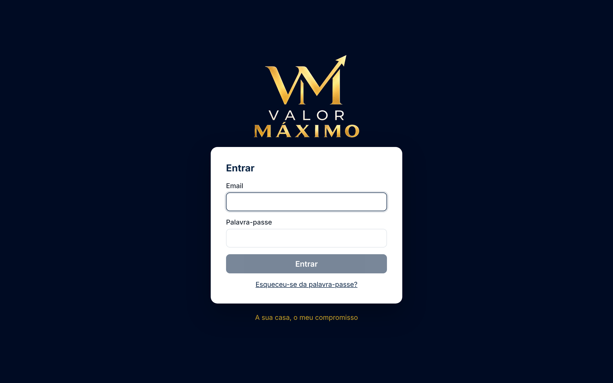
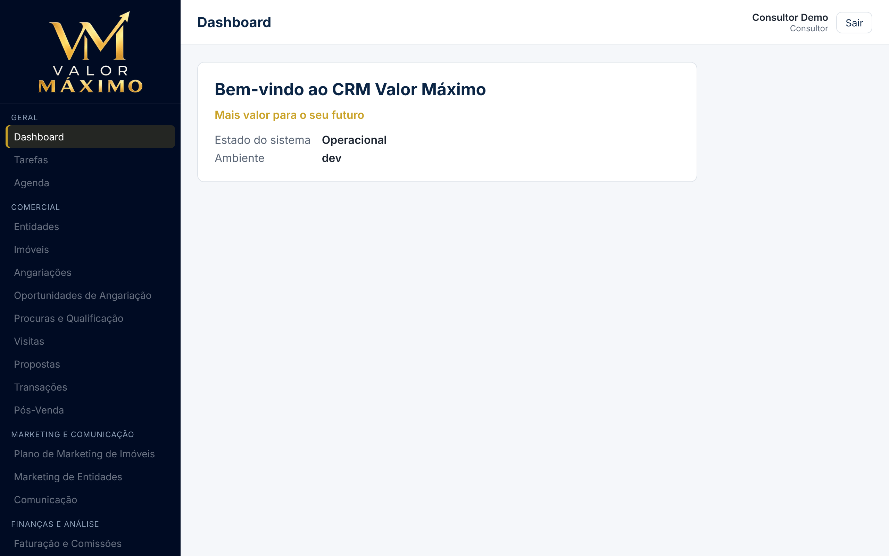
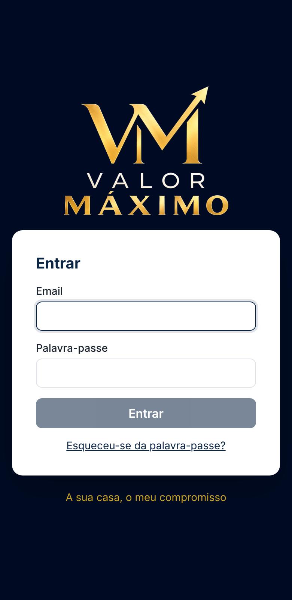

# 1. Entrar, sair e segurança da conta

## 1.1 Entrar na aplicação

1. Abra o endereço do CRM no browser do computador ou do telemóvel.
2. Escreva o seu **email** e a sua **palavra-passe**.
3. Carregue em **Entrar**.

Se o email ou a palavra-passe estiverem errados, aparece a mensagem *«Email ou palavra-passe incorretos»*.
Por segurança, a mensagem não indica qual dos dois está errado.

Depois de **10 tentativas falhadas num minuto**, a entrada fica bloqueada durante cerca de um minuto.

## 1.2 O ecrã principal

- **Menu lateral** (à esquerda): os módulos estão agrupados por área. Só aparecem os módulos a que o seu
  perfil tem acesso.
- **Cabeçalho**: mostra o módulo em que está, o seu nome, o seu perfil e o botão **Sair**.
- **No telemóvel**: o menu fica escondido; abra-o com o botão **☰** no canto superior esquerdo.

## 1.3 Sair

Carregue em **Sair**, no canto superior direito. Faça-o sempre num computador partilhado.
A sessão termina também automaticamente ao fim de 10 horas.

## 1.4 Esqueci-me da palavra-passe

1. No ecrã de entrada, carregue em **Esqueceu-se da palavra-passe?**
2. Escreva o seu email e carregue em **Enviar instruções**.
3. Receberá um email com uma ligação. A ligação é válida durante **2 horas** e só pode ser usada uma vez.
4. Defina a nova palavra-passe (mínimo de 12 caracteres; evite palavras comuns ou só números).

> Por segurança, a aplicação responde sempre da mesma forma, exista ou não uma conta com esse email.

## 1.5 Verificação em dois passos

A verificação em dois passos protege a conta mesmo que alguém descubra a palavra-passe. É
**obrigatória para Administradores**.

### Ativar (apenas na primeira vez)

1. Instale no telemóvel uma aplicação de autenticação, por exemplo **Google Authenticator** ou
   **Microsoft Authenticator**.
2. Entre no CRM com email e palavra-passe. Aparece o ecrã **Ativar verificação em dois passos**.
3. Na aplicação do telemóvel, adicione uma conta e leia o **código QR**. (Em alternativa, escreva o código
   de texto que aparece por baixo.)
4. Escreva o código de 6 dígitos que a aplicação mostra e carregue em **Ativar**.

5. Aparecem **10 códigos de recuperação**. Guarde-os num local seguro (por exemplo, impressos num cofre ou
   num gestor de palavras-passe). Cada código permite entrar **uma única vez** se perder o telemóvel.
   **Não voltam a ser mostrados.**

### Entrar com a verificação ativa

1. Escreva email e palavra-passe, como habitualmente.
2. Escreva o código de 6 dígitos que a aplicação do telemóvel mostra nesse momento e carregue em **Confirmar**.
   Tem **5 minutos** para o fazer.

**Dicas**
- O código muda a cada 30 segundos. Se for recusado, espere pelo seguinte.
- Se os códigos forem sempre recusados, confirme que a hora do telemóvel está em modo automático.
- Cada código só pode ser usado uma vez.

### Perdi o telemóvel

- Use um dos seus **códigos de recuperação** no lugar do código de 6 dígitos.
- Se não tiver códigos, peça a outro Administrador para **repor a verificação em dois passos** da sua conta.
  Na entrada seguinte terá de a ativar de novo.

### Desligar a verificação em dois passos

Por omissão é **obrigatória para os Administradores**. O Administrador pode torná-la opcional em
**Configurações → Parâmetros** → *Exigir início de sessão em dois passos aos Administradores* → **Não**
(anexo A). Recomendamos mantê-la ligada.

Quando não é obrigatória para o seu perfil, pode desligá-la:

1. Carregue no seu **nome**, no canto superior direito. Abre **A minha conta**.
2. Em **Início de sessão em dois passos**, escreva a sua **palavra-passe** e um **código** atual da aplicação do
   telemóvel (ou um código de recuperação).
3. Carregue em **Desligar o início de sessão em dois passos**.

Da próxima vez entra só com email e palavra-passe. Se o Administrador voltar a pôr o parâmetro em **Sim**, na
entrada seguinte é pedido para ativar de novo.

## 1.6 No telemóvel

A aplicação adapta-se ao ecrã do telemóvel e pode ser **instalada no ecrã inicial**, como uma aplicação:
- **Android (Chrome):** menu ⋮ → *Adicionar ao ecrã principal*.
- **iPhone (Safari):** botão Partilhar → *Adicionar ao ecrã principal*.

É sempre necessária ligação à Internet.

