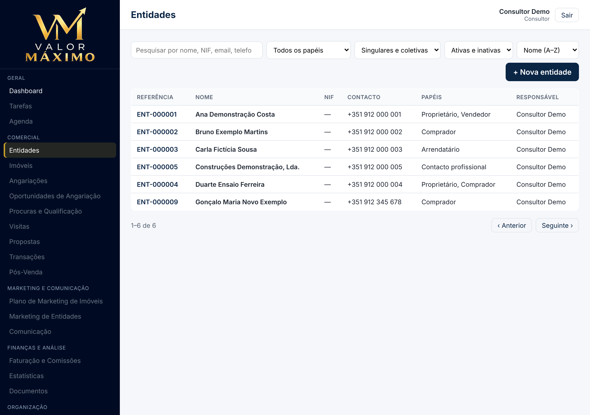
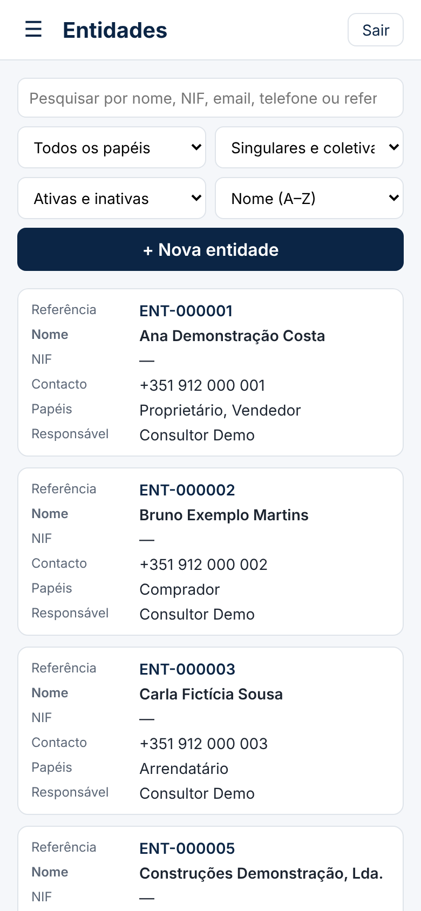
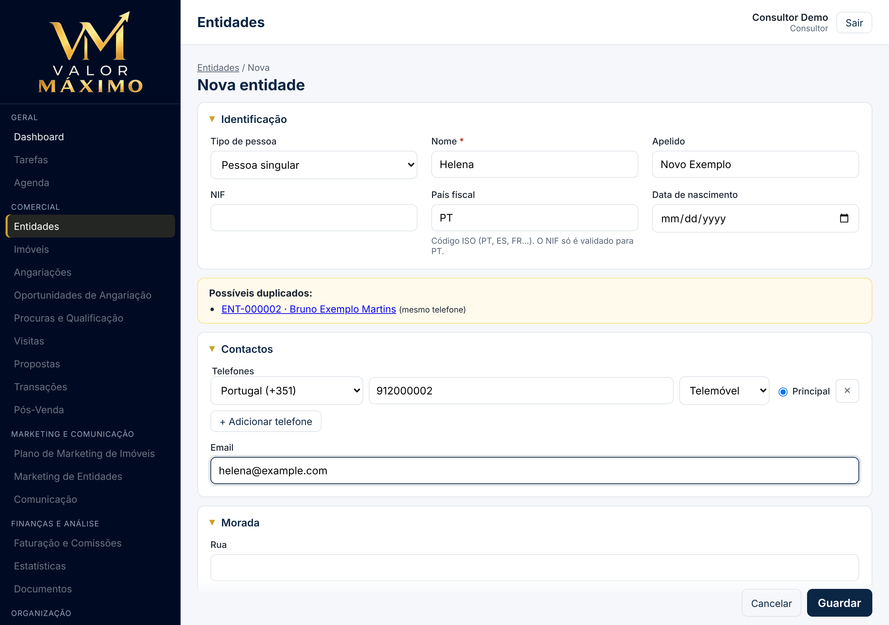
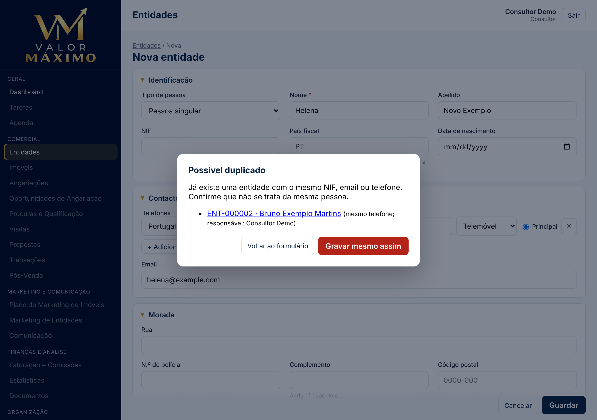
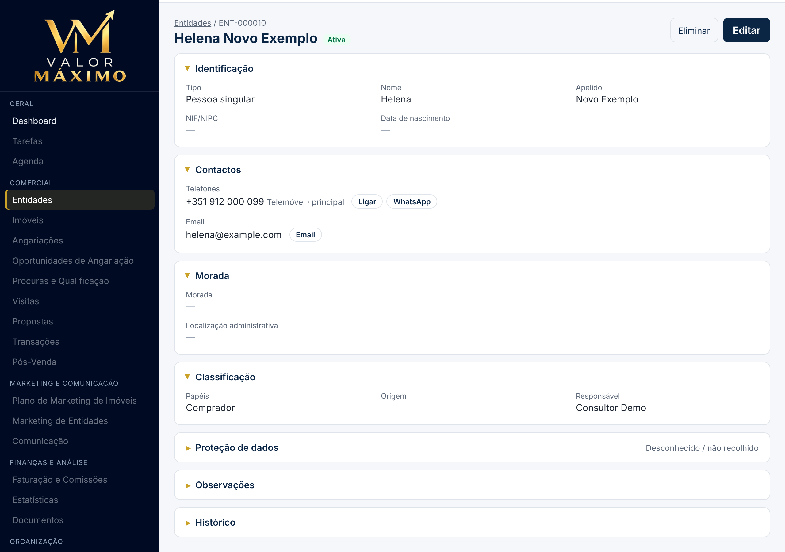
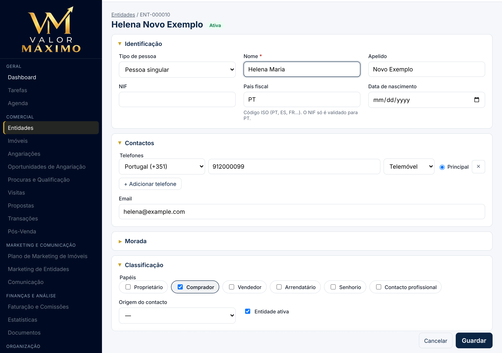
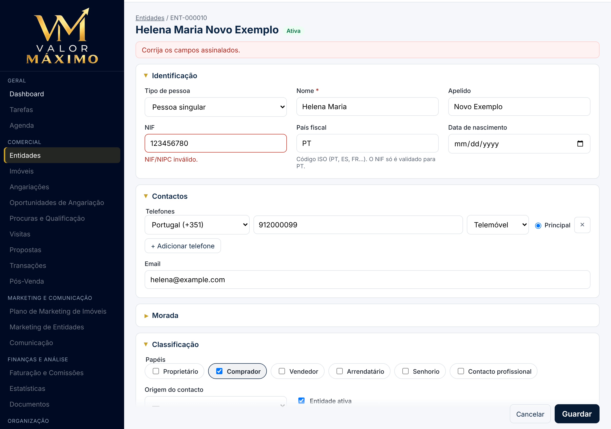
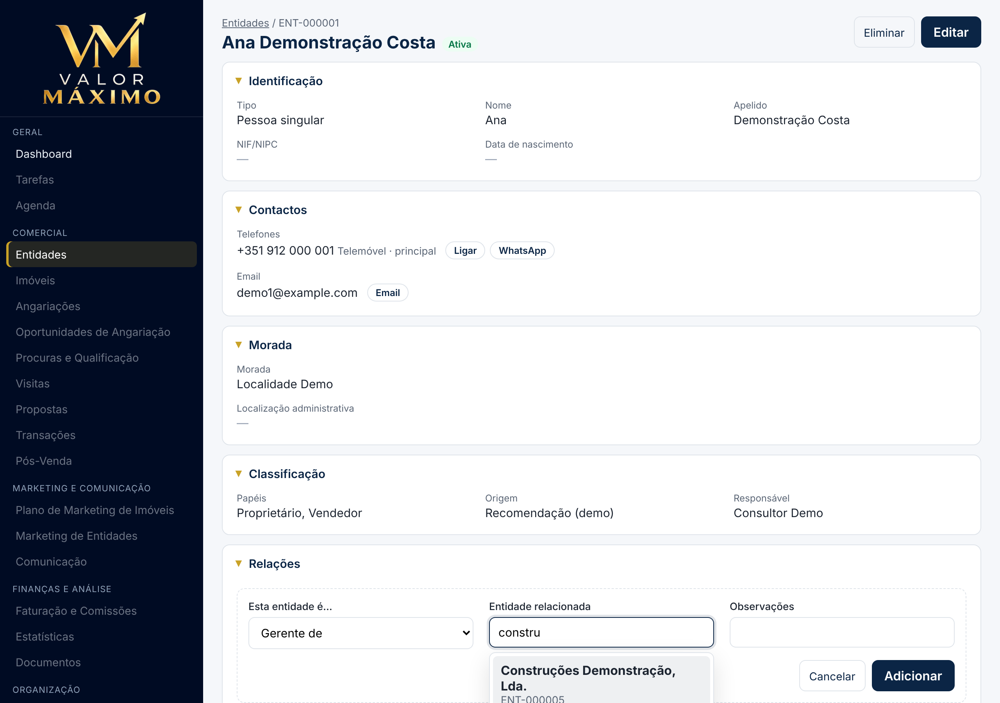
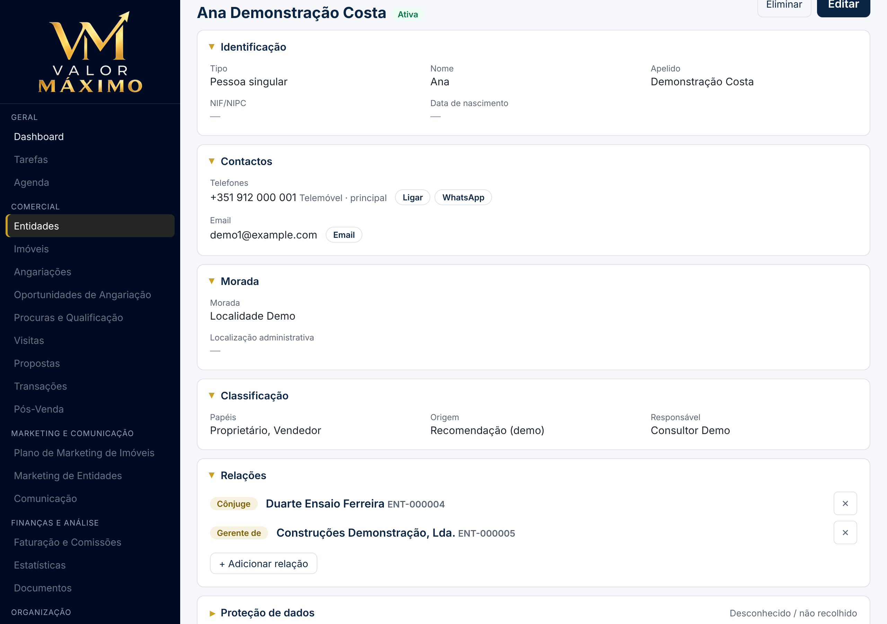

# 3. Entidades

As **Entidades** são as pessoas e empresas com quem trabalha: proprietários, compradores, vendedores,
arrendatários, senhorios, contactos profissionais, etc. Cada pessoa existe **uma só vez** no CRM, mesmo que
tenha vários **tipos de cliente** (por exemplo, é proprietária de um imóvel e compradora de outro).

> O tipo de cliente de uma entidade não lhe dá qualquer acesso à aplicação.

## 3.1 Lista de entidades

Abra **Entidades** no menu lateral.

- **Pesquisa:** escreva parte do nome, NIF, email, telefone ou a referência (ENT-…). A pesquisa ignora
  acentos e maiúsculas: «jose» encontra «José».
- **Filtros:** tipo de cliente, tipo de pessoa (singular/coletiva) e **Status** (Ativo, Inativo…).
- **Ordenar:** por nome, mais recentes ou referência.
- Clique numa linha para abrir a ficha.

Só vê as entidades a que o seu perfil dá acesso (por exemplo, o Consultor vê as suas e as que lhe foram
partilhadas; o Responsável de Equipa vê as da equipa).

No telemóvel, a lista aparece em cartões:

## 3.2 Criar uma entidade

1. Na lista, carregue em **+ Nova entidade**.
2. Escolha o **tipo de pessoa**. Para empresas, escolha *Pessoa coletiva*: o campo passa a chamar-se
   *Denominação social* e não há apelido nem data de nascimento.
3. Preencha os dados. Só o **nome** é obrigatório. Os blocos são:
   - **Identificação:** tipo de pessoa, nome, apelido, NIF e país fiscal;
   - **Contactos:** telefones e email;
   - **Morada:** rua, código postal, localidade, freguesia/concelho/distrito e **Zona**;
   - **Dados pessoais** (só pessoas singulares): data de nascimento, estado civil, regime de casamento,
     nacionalidade, CC/Passaporte, freguesia e concelho de naturalidade, empresa, cargo e observações;
   - **Classificação:** **Tipo de cliente** (Proprietário, Comprador…), **Status**, **Origem do contacto**,
     **Quem recomendou** (outra entidade), **Imóvel de contacto** (o imóvel pelo qual o contacto chegou),
     **Visitou o imóvel de contacto** (Sim/Não) e, se não visitou, **Porque não visitou**.
4. Carregue em **Guardar**.

### Listas suspensas

Todos os campos de escolha são **listas suspensas**. Quando se pode escolher mais do que uma opção (por
exemplo, *Tipo de cliente*), carregue na lista, marque as opções pretendidas e carregue fora da lista para a
fechar. As opções de todas as listas são alteradas pelo Administrador, sem programação (anexo A).

### Quem recomendou e imóvel de contacto

1. Em **Quem recomendou**, escreva parte do nome, NIF ou referência de outra entidade e escolha-a na lista.
2. Em **Imóvel de contacto**, escreva algumas palavras do imóvel — por exemplo **10 T3 Maia** — e escolha-o.
   Aparecem todos os imóveis que tenham **todas** essas palavras (na referência, tipo, tipologia, morada,
   localidade, zona, freguesia, concelho, descrição ou proprietário), por qualquer ordem.

Só pode escolher entidades e imóveis a que tem acesso.

A referência (ENT-000001, ENT-000002, …) é atribuída automaticamente e nunca muda. Fica como responsável
quem cria a entidade.

### Telefones

- O país começa em **Portugal (+351)**; pode escolher outro país na lista.
- Escreva o número sem o indicativo (por exemplo, 912 345 678). A aplicação valida-o para o país escolhido.
- Pode ter vários telefones; marque um como **Principal**.
- Para acrescentar, carregue em **+ Adicionar telefone**; para remover, em **✕**.

### NIF/NIPC

O NIF português é validado (9 dígitos e dígito de controlo). Para contribuintes estrangeiros, altere o
**País fiscal** (ES, FR, …): nesse caso o número não é validado.

### Possíveis duplicados

Enquanto preenche, a aplicação procura entidades parecidas e mostra-as num aviso amarelo:

Se tentar guardar uma entidade com o **mesmo NIF, email ou telefone** de outra já existente, a aplicação pede
confirmação:

- Abra a entidade indicada para confirmar se é a mesma pessoa. Se for, **não crie outra**: use a existente.
- Se tiver a certeza de que são pessoas diferentes, carregue em **Gravar mesmo assim** (fica registado).
- Se a outra entidade pertencer a um colega, verá apenas que existe um registo semelhante, sem os dados.
  Fale com o Responsável de Equipa.

Nomes parecidos só geram um aviso; não impedem a gravação.

## 3.3 Consultar uma entidade

A ficha abre sempre em **modo de consulta**:

- Junto de cada telefone tem **Ligar** e **WhatsApp**; junto do email, **Email**. Estes botões apenas abrem
  a aplicação respetiva: **não enviam mensagens** nem as registam como enviadas.
- As secções abrem e fecham com um clique no título. *Proteção de dados*, *Observações* e *Histórico*
  começam fechadas.
- **Histórico:** mostra quem criou e alterou a entidade, quando, e o que mudou (valor antigo → novo).

## 3.4 Editar

1. Na ficha, carregue em **Editar** (canto superior direito).
2. Altere os dados e carregue em **Guardar**. Volta à ficha de consulta.

- Se houver um erro, a secção correspondente abre-se automaticamente e o campo fica assinalado a vermelho:

  

- Se tentar sair com alterações por guardar, a aplicação pergunta se quer mesmo sair.
- Se outra pessoa alterar a mesma entidade enquanto está a editar, ao guardar aparece a mensagem *«Esta
  entidade foi alterada por outra pessoa entretanto»*. Recarregue a ficha e volte a fazer as suas alterações;
  assim nenhuma alteração é perdida sem aviso.

## 3.5 Entidades relacionadas

Na secção **Entidades relacionadas** da ficha regista as ligações entre pessoas e empresas: cônjuge,
familiar, sócio, gerente, etc.

1. Abra a ficha da entidade e, em **Entidades relacionadas**, carregue em **+ Adicionar entidade relacionada**.
2. Em **Esta entidade é…**, escolha a relação **do ponto de vista desta entidade**. Por exemplo, na ficha da
   Ana: *Gerente de* (a Ana é gerente de uma empresa) ou *Tem como gerente* (se a ficha fosse a da empresa).
3. Em **Entidade relacionada**, escreva parte do nome, NIF ou referência e escolha na lista (também funciona
   com as setas e Enter).
4. Em **Data de aniversário**, confirme ou indique a data de nascimento da pessoa relacionada. Se já estiver
   na ficha dela, aparece preenchida. A data fica guardada **na ficha da pessoa relacionada** (servirá, no
   futuro, para enviar mensagens de parabéns). Só pode alterar esta data se puder editar essa entidade.
5. Carregue em **Adicionar**. A relação fica gravada de imediato.

Na lista, cada pessoa relacionada mostra o dia de aniversário (por exemplo, *Aniversário: 15 de março*).

A relação aparece automaticamente nas **duas fichas**, com o nome certo em cada uma: se a Ana é *Gerente de*
Construções Demonstração, na ficha da empresa aparece *Tem como gerente* Ana.

- Para corrigir uma relação (tipo ou observações), carregue em **Editar** ao lado dela.
- Para remover uma relação, carregue em **✕** ao lado dela e confirme.
- Se a outra entidade pertencer a um colega a que não tem acesso, verá apenas *«Entidade a que não tem
  acesso»*, sem nome nem dados.
- Os tipos de relação disponíveis são **Cônjuge**, **Familiar**, **Sócio de / Tem como sócio** e
  **Gerente de / Tem como gerente**. O Administrador pode criar outros.
- Os **tipos de cliente**, o **Status**, as **origens de contacto**, os **estados civis**, os **regimes de
  casamento** e as **zonas** são listas editáveis pelo Administrador (anexo A).

## 3.6 Imóveis da entidade

A secção **Imóveis (proprietária)** mostra os imóveis de que a entidade é proprietária, com a quota de cada
um (ver capítulo 4). Os proprietários registam-se na ficha do imóvel.

## 3.7 Proteção de dados (RGPD)

Na secção **Proteção de dados** registe:

- **Consentimento de marketing:** *Desconhecido / não recolhido* (valor inicial), *Concedido* ou *Recusado*.
  Se for *Concedido*, indique a **data** em que foi obtido.
- **Oposição a marketing:** se a pessoa se opôs, marque esta opção. Prevalece sobre qualquer consentimento.

Criar ou importar um contacto **não** significa que a pessoa deu consentimento.

## 3.8 Eliminar e restaurar

- Na ficha, **Eliminar** envia a entidade para a **lixeira**. Nada é apagado definitivamente.
- Um utilizador autorizado (por omissão, o Responsável de Equipa ou o Administrador) pode **restaurá-la**.
- Se a entidade deixou apenas de estar ativa (por exemplo, já não é cliente), prefira mudar o **Status**
  para *Inativo* em vez de a eliminar.

## 3.9 Quem pode fazer o quê

| Ação | Administrador | Responsável de Equipa | Consultor | Assistente |
|------|:---:|:---:|:---:|:---:|
| Consultar | Todas | Da equipa | As suas e partilhadas | Atribuídas e partilhadas |
| Criar / editar | Sim | Sim (equipa) | Sim (as suas) | Sim (atribuídas) |
| Eliminar (lixeira) | Sim | Sim (equipa) | Sim (as suas) | Não |
| Restaurar | Sim | Sim (equipa) | Não | Não |
| Mudar o responsável | Sim | Dentro da equipa | Não | Não |
| Adicionar/remover relações | Sim | Sim (equipa) | Sim (as suas) | Sim (atribuídas) |

O Administrador pode ajustar estas permissões.
