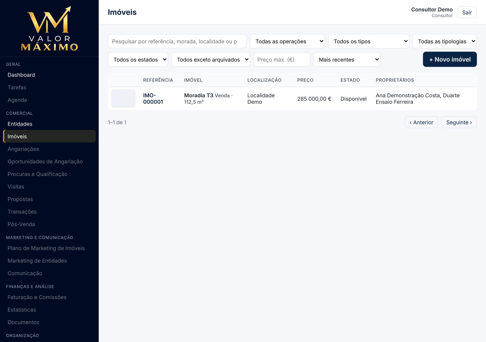
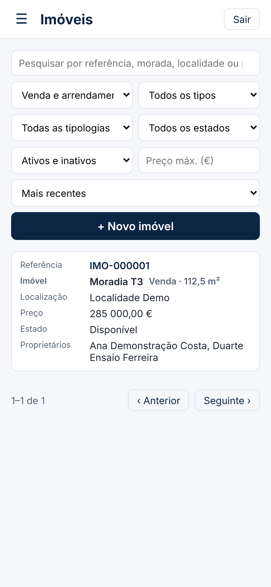
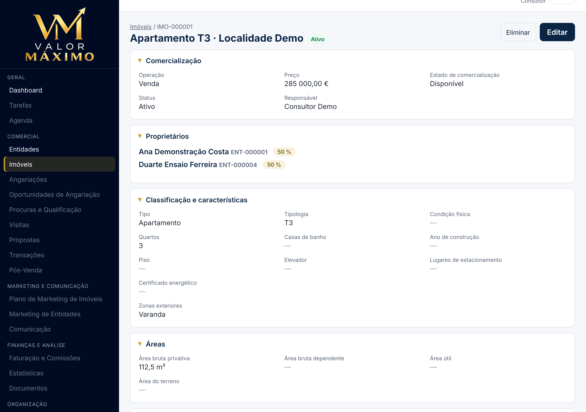
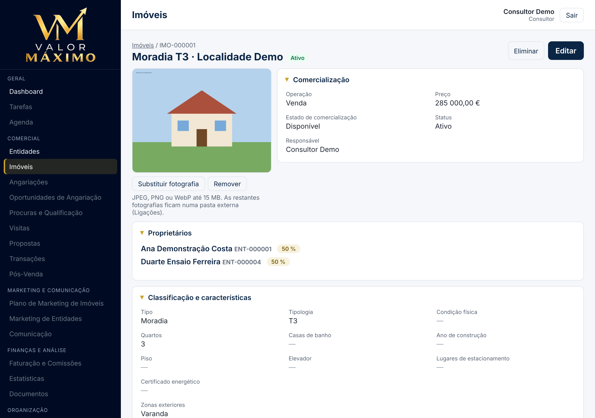
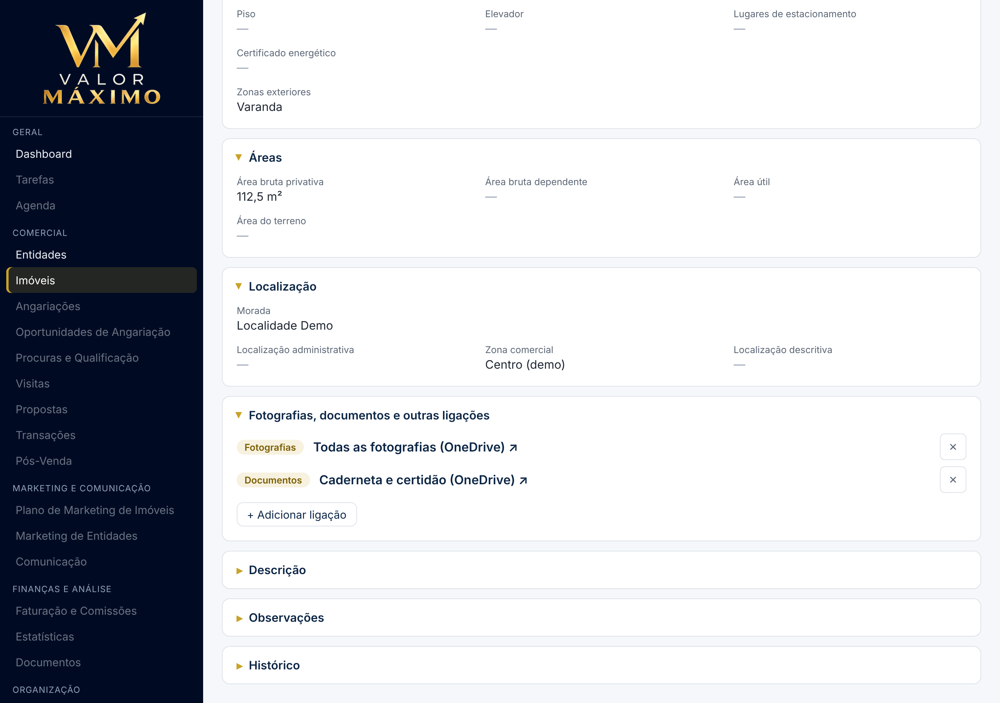

# 4. Imóveis

Cada imóvel tem uma **referência única** (IMO-000001, IMO-000002, …), atribuída automaticamente.

## 4.1 Lista de imóveis

Abra **Imóveis** no menu lateral.

- **Pesquisa:** escreva uma ou várias palavras, por exemplo **10 T3 Maia**. Aparecem os imóveis que tenham
  **todas** essas palavras, por qualquer ordem, na referência, tipo, tipologia, rua, localidade, zona,
  freguesia, concelho, localização descritiva, descrição ou nome de um proprietário. Ignora acentos e
  maiúsculas. A mesma pesquisa funciona sempre que tem de escolher um imóvel (angariações, oportunidades,
  imóvel de contacto de uma entidade).
- **Filtros:** operação (venda/arrendamento), tipo, tipologia, estado de comercialização, status e preço
  máximo.
- **Ordenar:** mais recentes, preço (crescente/decrescente) ou referência.
- Por omissão, os imóveis **arquivados não aparecem**. Para os ver, escolha *Arquivado* no filtro de status.

No telemóvel a lista aparece em cartões:

## 4.2 Criar um imóvel

1. Na lista, carregue em **+ Novo imóvel**.
2. Preencha as secções (nenhum campo é obrigatório além da operação; pode completar mais tarde).
3. Carregue em **Guardar**.

O formulário tem 10 separadores, por esta ordem:

### 1. Comercialização

- **Operação:** por exemplo Venda ou Arrendamento (lista editável pelo Administrador).
- **Estado de comercialização:** em que ponto está a comercialização (Em preparação, Disponível, Proposta,
  Reservado, Vendido, Arrendado, Retirado…). É a parte final da «fase de angariação»: as fases anteriores
  (Contacto, Pré-angariação, ACM apresentado, Pendente) registam-se na **oportunidade de angariação** e o
  contrato tem o seu próprio estado, calculado automaticamente (capítulo 5).
- **Status:** por omissão *Ativo*, *Inativo* ou *Arquivado* (lista editável). Use *Arquivado* para imóveis
  que já não interessam ao dia a dia, sem os eliminar. Se não escolher nenhum, o imóvel fica *Ativo*.
- **Valor (€):** deixe **vazio** se ainda não for conhecido. Vazio é diferente de 0 €.
- **Link do site:** endereço do anúncio do imóvel.

### 2. Identificação

Tipo de imóvel, tipologia, **estado do imóvel** (Novo, Usado, Reabilitado, Restaurado, Ruína), destino do
imóvel, ocupação e habitável.

### 3. Proprietários e quotas

1. Em **Acrescentar proprietário**, escreva parte do nome, NIF ou referência da entidade e escolha-a na lista.
2. Indique a **quota** de cada proprietário, em percentagem (por exemplo, 50).
3. Repita para cada proprietário. Para retirar um, carregue em **✕**.

- A quota é opcional. Se a indicar, a soma de todas não pode passar de 100 %; a aplicação mostra a soma
  enquanto preenche.
- Se o proprietário ainda não existir, use **Criar nova entidade** (abre noutro separador) e depois volte e
  procure-o.
- Proprietários a que não tem acesso aparecem como *«Entidade a que não tem acesso»*: mantêm-se no imóvel,
  mas não os pode alterar.
- Os proprietários são também as **partes** dos contratos (CMI) em curso deste imóvel: ao alterá-los aqui, as
  partes desses contratos atualizam-se sozinhas (capítulo 5).

### 4. Caracterização

Situação do imóvel, ano de construção, conservação, acabamentos, piso, **elevadores** (Não, 1, 2…),
**garagem** (1 lugar, Box 2 lugares…), piscina e zonas exteriores (pode escolher várias). O número de lugares de
estacionamento usado nas procuras é tirado da garagem (por exemplo, «Box 2 lugares» conta como 2).

### 5. Divisões

Quartos, suites, quartos +1, salas, WCs, WCs de serviço, cozinha, marquise, lavandaria (quantas), arrumação e
**outras** (texto livre, por exemplo «escritório, sótão»).

### 6. Equipamentos e conforto

Classe energética, n.º do certificado energético, climatização e caixilharias.

### 7. Áreas (m²)

Área bruta privativa, bruta dependente, útil, do lote, coberta, descoberta e de construção, a **fonte das
áreas** (CPU/R, CRP, planta…) e a **conformidade de áreas** (texto livre). Pode usar vírgula nas casas
decimais (112,5).

### 8. Informação registal

Artigo matricial, tipo de artigo (Urbano, Rústico, Misto), descrição do registo predial, licença de
habitabilidade, licença de construção e alvará de loteamento. Os documentos propriamente ditos ficam em pastas
do OneDrive, ligadas na secção *Fotografias, documentos e outras ligações* (4.5).

### 9. Localização

- **Link da localização** (por exemplo, do Google Maps).
- **Morada:** rua, número de polícia, complemento, código postal e localidade.
- **Distrito → Concelho → Freguesia** (catálogo oficial CAOP).
- **Zona comercial:** a zona de atuação da agência (lista própria, diferente das freguesias).
- **Localização descritiva:** texto livre, por exemplo *«junto ao parque da cidade»*.

### 10. Descrição e observações

Descrição do imóvel e observações internas.

Deixar um campo vazio significa *desconhecido*. Todas as opções das listas são editáveis pelo Administrador
(anexo A).

## 4.3 Consultar e editar

A ficha abre em consulta. Carregue em **Editar** para alterar e em **Guardar** para gravar.

- O preço aparece em euros e as áreas em m².
- Na secção **Proprietários**, clique num nome para abrir a ficha da entidade.
- O **Histórico** mostra todas as alterações com os nomes legíveis (por exemplo, *Tipo: Apartamento →
  Moradia*).
- As regras de edição são as mesmas das Entidades: aviso ao sair sem guardar, erros assinalados no campo e
  aviso se outra pessoa alterou o imóvel entretanto.

### Duplicar imóvel (nova comercialização)

Quando um imóvel vendido, cancelado ou rescindido **volta ao mercado**, não se reaproveita o registo antigo:
cria-se um **imóvel novo**, para que cada comercialização tenha os seus proprietários e contratos.

1. Abra a ficha do imóvel antigo e carregue em **Duplicar imóvel**.
2. Leia a explicação e carregue em **Duplicar**.
3. Abre-se a edição do imóvel novo, já com as mesmas características, proprietários e fotografia, e no estado
   *Em preparação*. Atualize o que mudou — em especial os **proprietários** — e carregue em **Guardar**.

O imóvel novo mostra um aviso com a ligação ao imóvel de origem. O imóvel antigo fica intacto, com o seu
histórico e contratos. As ligações a pastas do OneDrive não são copiadas.

## 4.4 Fotografia principal

Cada imóvel tem **uma** fotografia guardada no CRM, para o identificar facilmente (aparece na ficha e, em
miniatura, na lista).

1. Abra a ficha do imóvel (não é preciso carregar em Editar).
2. Carregue em **Carregar fotografia** (ou **Substituir fotografia**) e escolha a imagem (JPEG, PNG ou WebP,
   até 15 MB). Fica gravada de imediato.
3. Para a retirar, carregue em **Remover**.

A imagem é reduzida automaticamente e os dados escondidos da fotografia (por exemplo, a localização GPS do
telemóvel) são removidos. Clique na fotografia para a ver em tamanho maior.

## 4.5 Restantes fotografias, documentos e outras ligações

As restantes fotografias, os documentos (caderneta predial, certidões, plantas…) e outros ficheiros **não
são guardados no CRM**: ficam numa pasta do **OneDrive** (ou outro serviço), e o CRM guarda a **ligação**
para essa pasta.

1. No OneDrive, crie a pasta do imóvel e copie o **link de partilha** da pasta.
2. Na ficha do imóvel, secção **Fotografias, documentos e outras ligações**, carregue em
   **+ Adicionar ligação**.
3. Escolha o **tipo** (Fotografias, Documentos, Outro…), escreva um **título** e cole o **endereço**
   (tem de começar por https://).
4. Carregue em **Adicionar**.

- Clique numa ligação para a abrir num separador novo.
- Quem pode ver a pasta é decidido **no OneDrive** (permissões de partilha da pasta), não no CRM. Partilhe as
  pastas apenas com quem deve ter acesso.
- Remover uma ligação no CRM **não apaga** a pasta no OneDrive.

## 4.6 Imóveis na ficha da entidade

Na ficha de uma entidade, a secção **Imóveis (proprietária)** mostra os imóveis de que é proprietária e a
respetiva quota:

## 4.7 Eliminar

**Eliminar** envia o imóvel para a lixeira (pode ser restaurado por um utilizador autorizado). Se o imóvel
apenas deixou de estar em comercialização, prefira mudar o **Status** para *Inativo* ou *Arquivado*.
