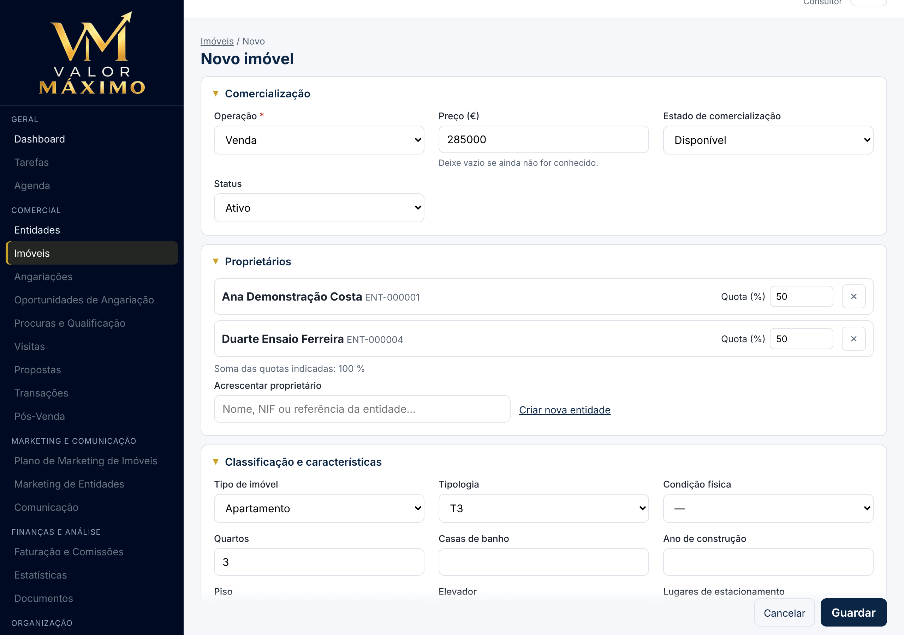
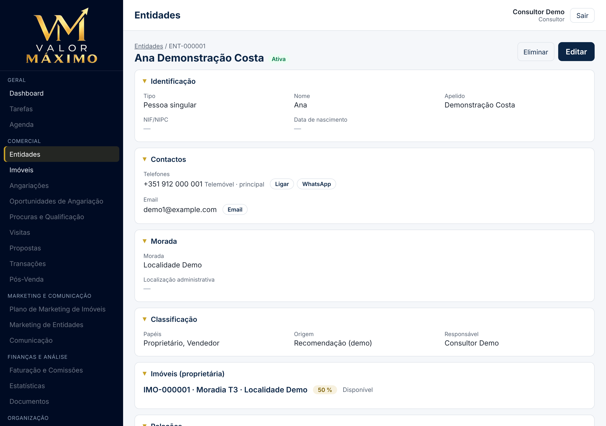

# 4. Imóveis

Cada imóvel tem uma **referência única** (IMO-000001, IMO-000002, …), atribuída automaticamente.

## 4.1 Lista de imóveis

Abra **Imóveis** no menu lateral.

- **Pesquisa:** referência, rua, localidade, freguesia, concelho, localização descritiva ou nome de um
  proprietário. Ignora acentos e maiúsculas.
- **Filtros:** operação (venda/arrendamento), tipo, tipologia, estado de comercialização, status e preço
  máximo.
- **Ordenar:** mais recentes, preço (crescente/decrescente) ou referência.
- Por omissão, os imóveis **arquivados não aparecem**. Para os ver, escolha *Arquivado* no filtro de status.

No telemóvel a lista aparece em cartões:

## 4.2 Criar um imóvel

1. Na lista, carregue em **+ Novo imóvel**.
2. Preencha as secções (nenhum campo é obrigatório além da operação; pode completar mais tarde).
3. Carregue em **Guardar**.

### Comercialização

- **Operação:** Venda ou Arrendamento.
- **Preço (€):** deixe **vazio** se ainda não for conhecido. Vazio é diferente de 0 €.
- **Estado de comercialização:** em que ponto está a comercialização (Em preparação, Disponível, Reservado,
  Vendido, Arrendado, Retirado…).
- **Status:** *Ativo*, *Inativo* ou *Arquivado*. Use *Arquivado* para imóveis que já não interessam ao
  dia a dia, sem os eliminar.

### Proprietários e quotas

1. Em **Acrescentar proprietário**, escreva parte do nome, NIF ou referência da entidade e escolha-a na lista.
2. Indique a **quota** de cada proprietário, em percentagem (por exemplo, 50).
3. Repita para cada proprietário. Para retirar um, carregue em **✕**.

- A quota é opcional. Se a indicar, a soma de todas não pode passar de 100 %; a aplicação mostra a soma
  enquanto preenche.
- Se o proprietário ainda não existir, use **Criar nova entidade** (abre noutro separador) e depois volte e
  procure-o.
- Proprietários a que não tem acesso aparecem como *«Entidade a que não tem acesso»*: mantêm-se no imóvel,
  mas não os pode alterar.
- Alterar os proprietários de um imóvel **não altera negócios já concluídos**: as propostas e transações
  guardam os participantes da altura.

### Classificação, características e áreas

Tipo, tipologia, condição física, quartos, casas de banho, ano de construção, piso, elevador, lugares de
estacionamento, certificado energético e zonas exteriores (pode escolher várias). As áreas são em m²; pode
usar vírgula nas casas decimais (112,5).

Nos campos *Elevador* e nos números, deixar vazio significa *desconhecido*.

### Localização

- **Morada:** rua, número, complemento, código postal e localidade.
- **Localização administrativa:** Distrito → Concelho → Freguesia (catálogo oficial CAOP).
- **Zona comercial:** a zona de atuação da agência (lista própria, diferente das freguesias).
- **Localização descritiva:** texto livre, por exemplo *«junto ao parque da cidade»*.

## 4.3 Consultar e editar

A ficha abre em consulta. Carregue em **Editar** para alterar e em **Guardar** para gravar.

- O preço aparece em euros e as áreas em m².
- Na secção **Proprietários**, clique num nome para abrir a ficha da entidade.
- O **Histórico** mostra todas as alterações com os nomes legíveis (por exemplo, *Tipo: Apartamento →
  Moradia*).
- As regras de edição são as mesmas das Entidades: aviso ao sair sem guardar, erros assinalados no campo e
  aviso se outra pessoa alterou o imóvel entretanto.

## 4.4 Imóveis na ficha da entidade

Na ficha de uma entidade, a secção **Imóveis (proprietária)** mostra os imóveis de que é proprietária e a
respetiva quota:

## 4.5 Eliminar

**Eliminar** envia o imóvel para a lixeira (pode ser restaurado por um utilizador autorizado). Se o imóvel
apenas deixou de estar em comercialização, prefira mudar o **Status** para *Inativo* ou *Arquivado*.
