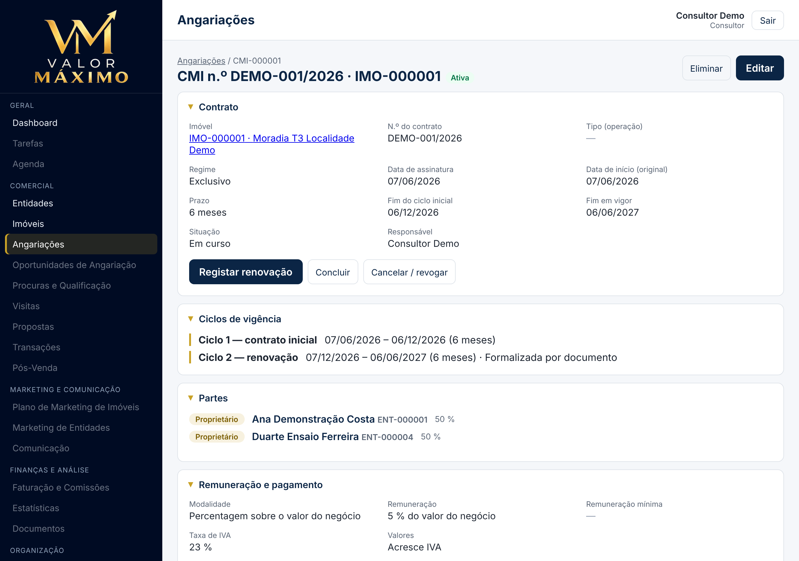

# 5. Angariações (CMI)

Uma **angariação** regista um **Contrato de Mediação Imobiliária (CMI)** para um imóvel: as partes, o regime,
a vigência, as renovações e a remuneração. Cada uma tem uma referência única (CMI-000001, …).

## 5.1 Lista de angariações

Abra **Angariações** no menu. Use os separadores para filtrar:

| Separador | Mostra |
|-----------|--------|
| Por assinar | Contratos registados mas ainda sem data de início e prazo |
| Em vigor | Contratos assinados dentro do período de vigência |
| A expirar | Contratos que terminam dentro do maior limiar de aviso (por omissão, 120 dias) |
| Expirados | Contratos cujo período terminou sem renovação |
| Concluídos / Cancelados | Contratos encerrados |

Cada linha mostra a miniatura da fotografia principal do imóvel. Pode pesquisar pela referência, n.º de contrato, imóvel, localidade ou nome de uma das partes, e ordenar pela
data de fim mais próxima.

## 5.2 Criar uma angariação

As angariações criam-se **sempre a partir do imóvel**: abra a ficha do imóvel e, na secção **Angariações
(CMI)**, carregue em **+ Nova angariação para este imóvel**. Se o imóvel ainda não existir, crie-o primeiro
(diretamente em Imóveis ou com **Criar imóvel** numa oportunidade de angariação).

1. **Contrato:** escolha o **imóvel** escrevendo algumas palavras (por exemplo **10 T3 Maia**: aparecem todos
   os imóveis que tenham essas palavras na referência, tipo, tipologia, morada, localidade, zona ou
   proprietário), o n.º do contrato, o tipo (operação — se não escolher, usa a do imóvel) e o regime
   (Exclusivo, Não exclusivo…).
2. **Datas:** quando o contrato estiver assinado, preencha a **data de início** e o **prazo em meses**. A
   **Data fim de contrato** aparece logo calculada: **início + prazo − 1 dia** (ex.: 01/01 + 6 meses → 30/06).
   Com as renovações, a data fim de contrato passa a ser a do último ciclo. Enquanto o contrato não estiver
   assinado, deixe a data de início e o prazo vazios: o CMI fica *Por assinar*.
3. **Partes:** os **proprietários** são sempre os do imóvel (com as quotas) e não se alteram aqui: para os
   mudar, edite os proprietários na ficha do imóvel e as partes dos contratos em curso atualizam-se sozinhas.
   Neste separador só acrescenta **outras partes** (Representante legal, Procurador…). Quando o contrato é
   concluído ou cancelado, as partes ficam guardadas como estavam.
4. **Remuneração e pagamento:** escolha a modalidade e o valor. As modalidades disponíveis dependem da operação:
   - **Venda:** percentagem sobre o valor do negócio ou valor fixo;
   - **Arrendamento:** número de rendas, valor fixo ou percentagem sobre uma base contratual (que tem de
     identificar).

   Indique a taxa de IVA e se os valores incluem IVA. Valor vazio = ainda não indicado; 0 = sem remuneração.

   **Momento do pagamento** (lista configurável): *100% no CPCV*, *50% no CPCV e 50% na escritura* ou *100%
   na escritura*. Em **Sinal mínimo do comprador** indique o sinal de que depende esse pagamento, em **% do
   preço** ou em **euros** (ex.: comissão paga no CPCV desde que o sinal seja de 15%). Use **Outras condições
   de pagamento** para o que não couber nestes campos.
5. **Acompanhamento:** prioridade, comercialização prevista (Imediato, Normal, Difícil, Muito difícil),
   **valor ACM** (análise comparativa de mercado), **valor vendido** e observações da angariação.
6. Carregue em **Guardar**.

### Tempo restante e comissão prevista

Na lista e na ficha, cada contrato ativo mostra quantos dias faltam para a **data fim de contrato**, com uma
cor:

| Cor | Dias que faltam |
|-----|-----------------|
| Vermelho | 30 ou menos |
| Laranja | 31 a 60 |
| Amarelo | 61 a 120 |
| Verde | mais de 120 |

Os limites (30, 60 e 120) são um parâmetro que o Administrador pode alterar.

Na secção *Remuneração e pagamento* aparece a **comissão prevista**: preço do imóvel × percentagem (ou o valor
vendido, quando estiver preenchido), ou o valor fixo, nunca abaixo da remuneração mínima. É uma estimativa
sem IVA; o valor oficial será o da faturação.

> As partes do contrato ficam guardadas no próprio CMI: se mais tarde os proprietários do imóvel mudarem, o
> contrato mantém as partes que o assinaram.

### Contratos exclusivos

O CRM **não deixa registar** um contrato cujo período se sobreponha ao de outro contrato **exclusivo** em
curso para o mesmo imóvel e a mesma operação. Aparece a mensagem *«Sobrepõe-se a contrato(s) exclusivo(s)…»*
com a referência do outro contrato. Contratos não exclusivos podem coexistir.

## 5.3 Consultar

- **Fotografia do imóvel:** aparece ao lado dos dados do contrato; clique nela para abrir a ficha do imóvel.
- **Avisos de expiração:** quando faltam 120, 60 ou 30 dias (valores configuráveis) para o fim, aparece um aviso
  vermelho no topo da ficha e na lista.
- **Ciclos de vigência:** o contrato inicial (ciclo 1) e cada renovação (ciclo 2, 3, …).
- **Documentos e ligações:** ligue o CMI digitalizado e outros documentos guardados no OneDrive.

## 5.4 Renovar

1. Na ficha, carregue em **Registar renovação**.
2. A data de início é proposta automaticamente (dia seguinte ao fim do ciclo atual) e o prazo é o do contrato.
3. Escolha a **forma** (automática, prevista no contrato, ou formalizada por documento) e confirme.

A renovação **não altera** a data de início original do contrato nem os ciclos anteriores: cria um novo ciclo.

## 5.5 Datas depois de assinado e correção excecional

Depois de assinado, a data de início e o prazo **não se alteram na edição normal**. Se
foram registados com um erro, quem pode editar o CMI pode fazer uma **Correção excecional**:

1. Na ficha, carregue em **Correção excecional**.
2. Escolha o dado, indique o valor correto, o **motivo** e a **evidência** (por exemplo, o CMI digitalizado).
3. Carregue em **Corrigir**.

A correção fica registada na secção **Correções excecionais** (valor anterior, novo, motivo, evidência, quem e
quando) e na auditoria.

## 5.6 Concluir, cancelar e reabrir

- **Concluir:** o negócio foi realizado ao abrigo deste contrato.
- **Cancelar / revogar:** o contrato terminou antes do fim (revogação, rescisão…).
- **Reabrir:** volta a pôr o contrato em curso.

Em todos os casos é pedido um motivo, que fica registado.

## 5.7 Limiares de aviso (Administrador)

Em **Configurações → Parâmetros** pode alterar os dias de aviso (por omissão **120, 60, 30**).

