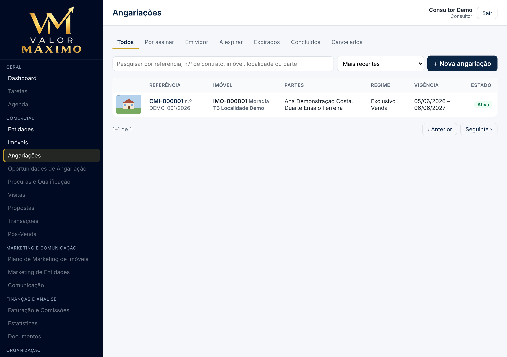
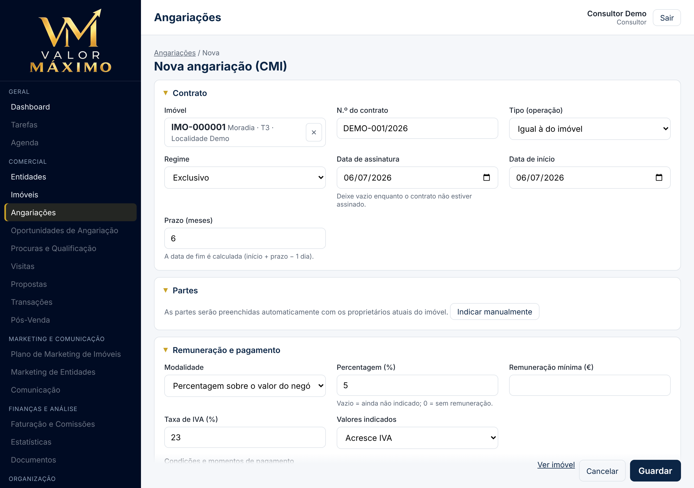
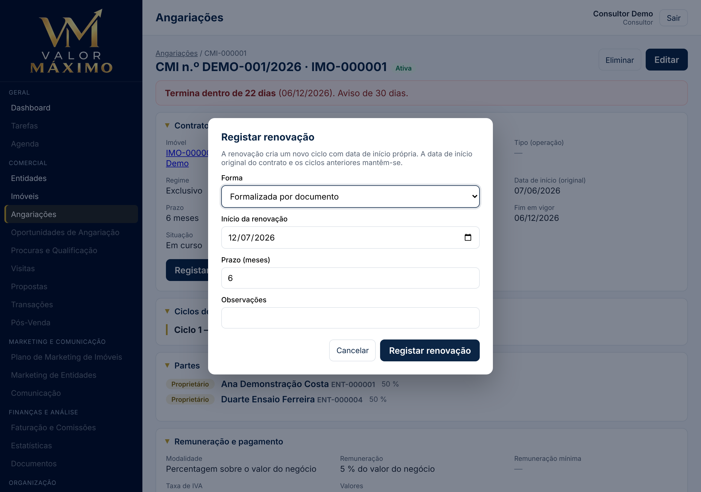
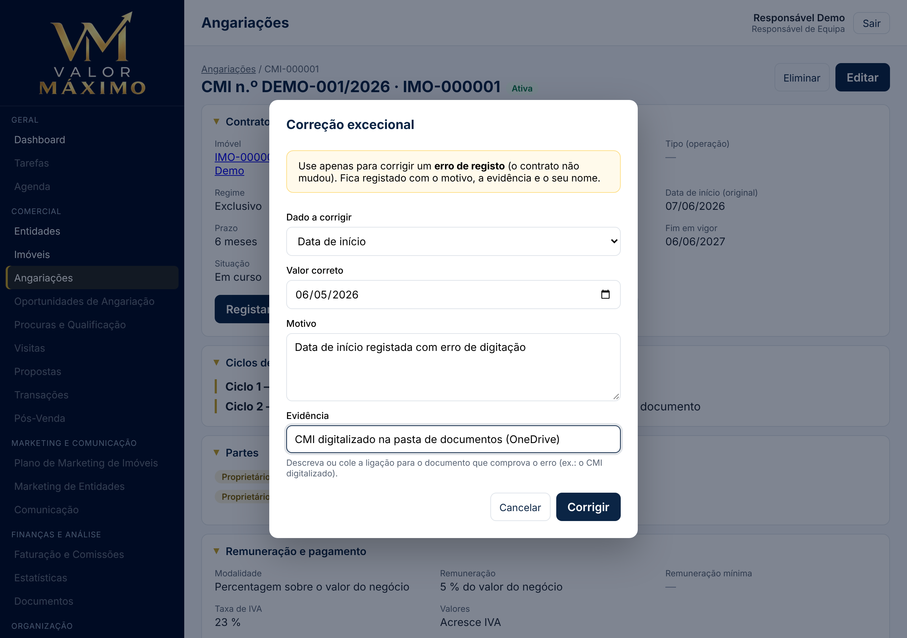
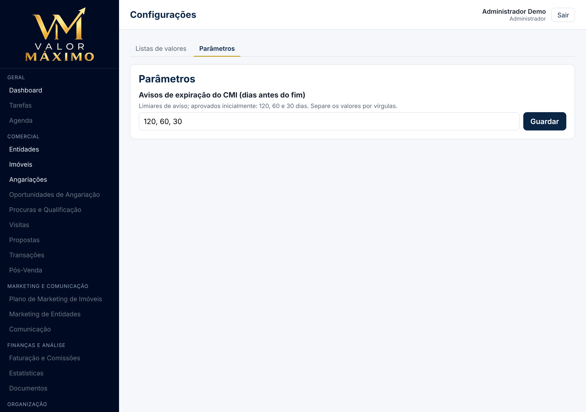

# 5. Angariações (CMI)

Uma **angariação** regista um **Contrato de Mediação Imobiliária (CMI)** para um imóvel: as partes, o regime,
a vigência, as renovações e a remuneração. Cada uma tem uma referência única (CMI-000001, …).

## 5.1 Lista de angariações

Abra **Angariações** no menu. Use os separadores para filtrar:

| Separador | Mostra |
|-----------|--------|
| Por assinar | Contratos registados mas ainda sem data de assinatura |
| Em vigor | Contratos assinados dentro do período de vigência |
| A expirar | Contratos que terminam dentro do maior limiar de aviso (por omissão, 120 dias) |
| Expirados | Contratos cujo período terminou sem renovação |
| Concluídos / Cancelados | Contratos encerrados |

Cada linha mostra a miniatura da fotografia principal do imóvel. Pode pesquisar pela referência, n.º de contrato, imóvel, localidade ou nome de uma das partes, e ordenar pela
data de fim mais próxima.

## 5.2 Criar uma angariação

A forma mais simples é a partir da ficha do imóvel: secção **Angariações (CMI)** → **+ Nova angariação para
este imóvel**. Também pode usar **+ Nova angariação** na lista e escolher o imóvel.

1. **Contrato:** n.º do contrato, tipo (operação — se não escolher, usa a do imóvel) e regime (Exclusivo,
   Não exclusivo…).
2. **Datas:** preencha a **data de assinatura**, a **data de início** e o **prazo em meses** quando o contrato
   estiver assinado. A data de fim é calculada: **início + prazo − 1 dia** (ex.: 01/01 + 6 meses → 30/06).
   Enquanto não estiver assinado, deixe a data de assinatura vazia.
3. **Partes:** são preenchidas automaticamente com os proprietários atuais do imóvel (e as quotas). Pode
   indicá-las manualmente e escolher o papel (Proprietário, Representante legal, Procurador…).
4. **Remuneração e pagamento:** escolha a modalidade e o valor. As modalidades disponíveis dependem da operação:
   - **Venda:** percentagem sobre o valor do negócio ou valor fixo;
   - **Arrendamento:** número de rendas, valor fixo ou percentagem sobre uma base contratual (que tem de
     identificar).

   Indique a taxa de IVA e se os valores incluem IVA. Valor vazio = ainda não indicado; 0 = sem remuneração.
5. Carregue em **Guardar**.

> As partes do contrato ficam guardadas no próprio CMI: se mais tarde os proprietários do imóvel mudarem, o
> contrato mantém as partes que o assinaram.

### Contratos exclusivos

O CRM **não deixa registar** um contrato cujo período se sobreponha ao de outro contrato **exclusivo** em
curso para o mesmo imóvel e a mesma operação. Aparece a mensagem *«Sobrepõe-se a contrato(s) exclusivo(s)…»*
com a referência do outro contrato. Contratos não exclusivos podem coexistir.

## 5.3 Consultar

- **Fotografia do imóvel:** aparece ao lado dos dados do contrato; clique nela para abrir a ficha do imóvel.
- **Avisos de expiração:** quando faltam 120, 60 ou 30 dias (valores configuráveis) para o fim, aparece um aviso
  vermelho no topo da ficha e na lista.
- **Ciclos de vigência:** o contrato inicial (ciclo 1) e cada renovação (ciclo 2, 3, …).
- **Documentos e ligações:** ligue o CMI digitalizado e outros documentos guardados no OneDrive.

## 5.4 Renovar

1. Na ficha, carregue em **Registar renovação**.
2. A data de início é proposta automaticamente (dia seguinte ao fim do ciclo atual) e o prazo é o do contrato.
3. Escolha a **forma** (automática, prevista no contrato, ou formalizada por documento) e confirme.

A renovação **não altera** a data de início original do contrato nem os ciclos anteriores: cria um novo ciclo.

## 5.5 Datas depois de assinado e correção excecional

Depois de assinado, a data de assinatura, a data de início e o prazo **não se alteram na edição normal**. Se
foram registados com um erro, um utilizador com permissão de aprovação (por omissão, Responsável de Equipa ou
Administrador) pode fazer uma **Correção excecional**:

1. Na ficha, carregue em **Correção excecional**.
2. Escolha o dado, indique o valor correto, o **motivo** e a **evidência** (por exemplo, o CMI digitalizado).
3. Carregue em **Corrigir**.

A correção fica registada na secção **Correções excecionais** (valor anterior, novo, motivo, evidência, quem e
quando) e na auditoria.

## 5.6 Concluir, cancelar e reabrir

- **Concluir:** o negócio foi realizado ao abrigo deste contrato.
- **Cancelar / revogar:** o contrato terminou antes do fim (revogação, rescisão…).
- **Reabrir:** volta a pôr o contrato em curso (exige permissão de aprovação).

Em todos os casos é pedido um motivo, que fica registado.

## 5.7 Limiares de aviso (Administrador)

Em **Configurações → Parâmetros** pode alterar os dias de aviso (por omissão **120, 60, 30**).

