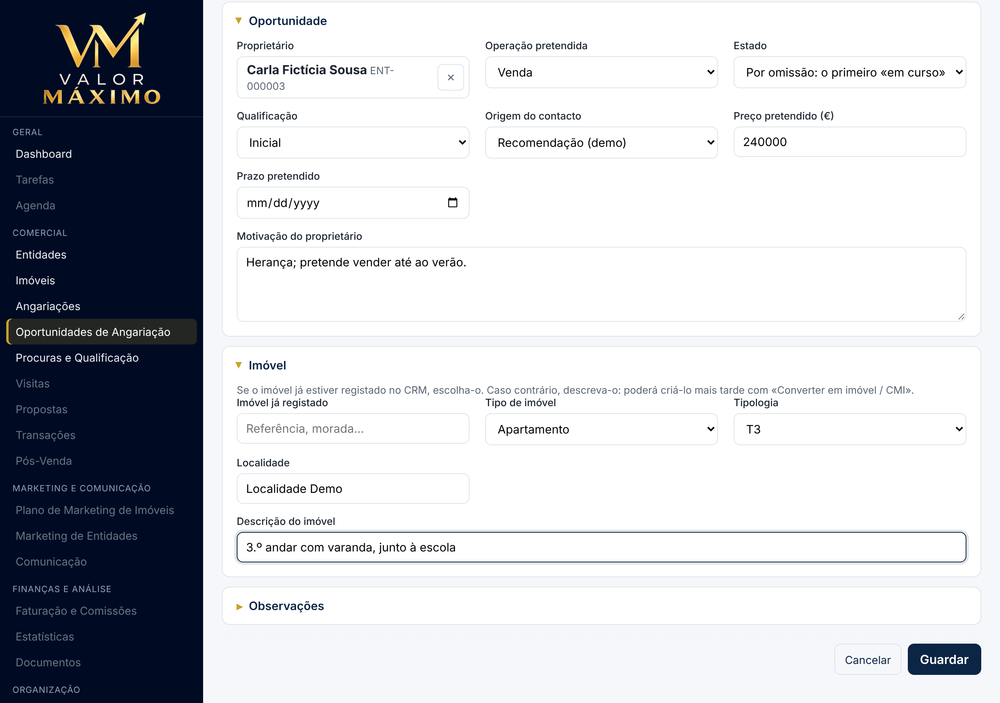

# 6. Oportunidades de Angariação

Uma **oportunidade** regista um contacto com um proprietário **antes** de existir um contrato (CMI): quem é,
que imóvel tem, o que pretende e em que ponto está a conversa. Referência: OPA-000001, …

> Uma oportunidade **não é** uma angariação. O passo seguinte é **criar o imóvel**; o CMI cria-se depois, na
> ficha do imóvel.

## 6.1 Lista

Abra **Oportunidades de Angariação** no menu. Os separadores mostram as oportunidades **em curso**,
**angariadas** e **perdidas**. Pode pesquisar pelo proprietário, localidade ou referência e filtrar por estado.

## 6.2 Criar

A forma mais rápida é a partir da ficha da entidade (o proprietário): secção **Oportunidades e procuras** →
**+ Nova oportunidade**. Também pode usar **+ Nova oportunidade** na lista.

1. **Oportunidade:** proprietário, operação pretendida (venda/arrendamento), estado, origem do contacto e
   **valor pretendido pelo imóvel**.
2. **Qualificação do proprietário:** destino do imóvel, ocupação, motivação de venda (de *Muito baixa* a
   *Muito alta*), se a venda depende da compra, **prazo para vender** (texto livre, como o cliente disse — por
   exemplo «até ao verão»), se é o único proprietário (se não for, aparece *Todos de acordo com a venda*),
   motivo da venda e o que fará se não vender.
3. **Imóvel:** se o imóvel já existir no CRM, escolha-o (pode escrever várias palavras, por exemplo «T3
   Maia»). Se não, descreva-o (tipo, tipologia, localidade e uma descrição curta). Em **Anúncio (site)** cole
   o endereço do anúncio, se o imóvel já estiver anunciado noutro site.
4. **Negócio:** quando e por quanto comprou, hipoteca associada e entidade bancária, se está à venda (e há
   quanto tempo), se teve visitas e propostas, **porque não vendeu**, (se teve propostas) o valor da proposta
   e porque não aceitou, como chegou ao valor pretendido, pontos positivos e objeções.
5. Carregue em **Guardar**.

As respostas *Sim / Não / Não sabe* e as restantes opções vêm de listas configuráveis (anexo A). Os campos de
qualificação podem ficar vazios e ser preenchidos mais tarde, à medida que conhece melhor o proprietário.

Se não escolher o estado, fica no primeiro estado «em curso» (por omissão, *Contacto*). Os estados iniciais
são as primeiras fases da angariação: *Contacto*, *Pré-angariação*, *ACM apresentado*, *Pendente*,
*Angariado* e *Cancelado* (lista editável).

## 6.3 Registar contactos

Na ficha, secção **Contactos registados**, carregue em **+ Registar contacto** e indique o tipo (chamada,
reunião, email…), quando foi e um resumo.

Se registou algo errado num contacto, carregue em **Editar** para o corrigir (o texto anterior fica guardado na
auditoria e o contacto mostra «corrigido por… em…»), ou em **Anular** (fica riscado, mas guardado). Os contactos
não se apagam.

## 6.4 Criar o imóvel e, depois, o CMI

Quando o proprietário aceitar avançar:

- **Se o imóvel ainda não está registado:**
  1. Na ficha da oportunidade, carregue em **Criar imóvel** e confirme.
  2. O CRM cria o **imóvel** com os dados da oportunidade (tipo, tipologia, localidade, descrição, valor
     pretendido) e o proprietário, e abre-o para o completar.
  3. Depois de guardar o imóvel, crie a angariação na ficha do imóvel: **Angariações (CMI)** → **+ Nova
     angariação para este imóvel**.
- **Se o imóvel já está registado:** carregue em **Abrir imóvel (atualizar e criar o CMI)**, atualize o que for
  preciso e crie a angariação a partir da ficha do imóvel.

A oportunidade fica ligada ao imóvel e não cria um segundo imóvel. O estado da oportunidade **não muda
sozinho**: quando o CMI for assinado, mude-o para *Angariado*.
