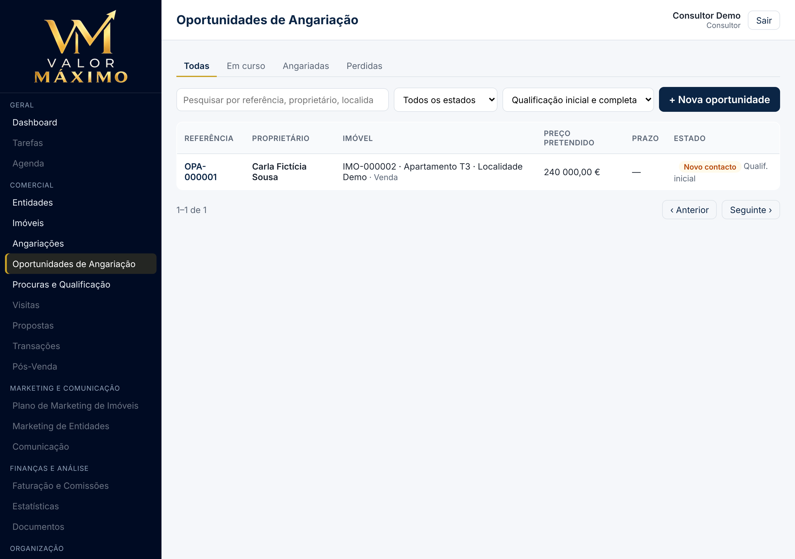
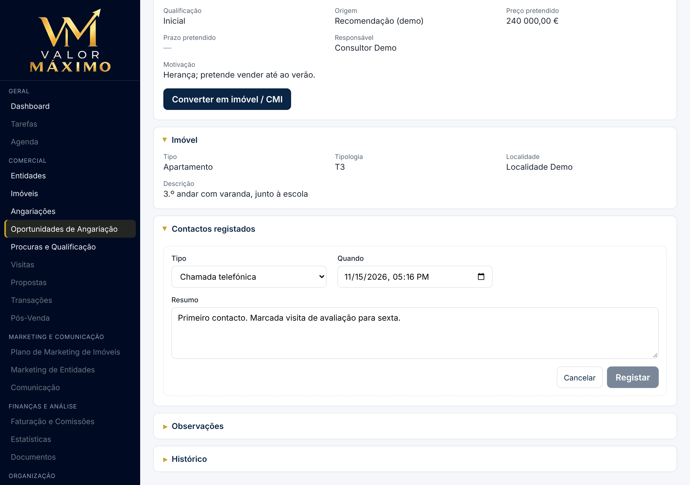
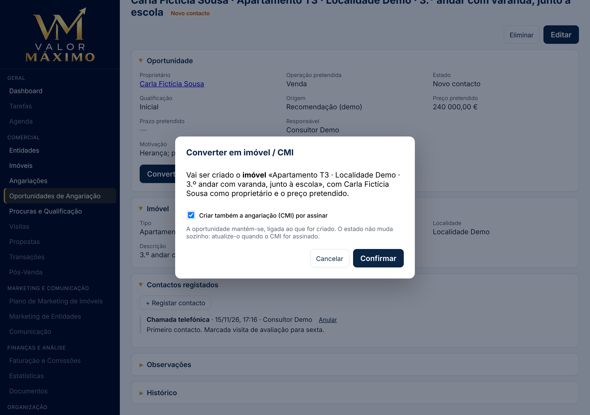

# 6. Oportunidades de Angariação

Uma **oportunidade** regista um contacto com um proprietário **antes** de existir um contrato (CMI): quem é,
que imóvel tem, o que pretende e em que ponto está a conversa. Referência: OPA-000001, …

> Uma oportunidade **não é** uma angariação. Só passa a imóvel/CMI quando carregar em **Converter**.

## 6.1 Lista

Abra **Oportunidades de Angariação** no menu. Os separadores mostram as oportunidades **em curso**,
**angariadas** e **perdidas**. Pode pesquisar pelo proprietário, localidade ou referência e filtrar por estado.

## 6.2 Criar

A forma mais rápida é a partir da ficha da entidade (o proprietário): secção **Oportunidades e procuras** →
**+ Nova oportunidade**. Também pode usar **+ Nova oportunidade** na lista.

1. **Oportunidade:** proprietário, operação pretendida (venda/arrendamento), estado, origem do contacto e
   **valor pretendido pelo imóvel**.
2. **Qualificação do proprietário:** destino do imóvel, ocupação, motivação de venda (de *Muito baixa* a
   *Muito alta*), se a venda depende da compra, **prazo para vender** (texto livre, como o cliente disse — por
   exemplo «até ao verão»), se é o único proprietário (se não for, aparece *Todos de acordo com a venda*),
   motivo da venda e o que fará se não vender.
3. **Negócio:** quando e por quanto comprou, hipoteca associada e entidade bancária, se está à venda (e há
   quanto tempo), se teve visitas e propostas (se teve, aparecem o valor da proposta e porque não aceitou),
   como chegou ao valor pretendido, pontos positivos e objeções.
4. **Imóvel:** se o imóvel já existir no CRM, escolha-o (pode escrever várias palavras, por exemplo «T3
   Maia»). Se não, descreva-o (tipo, tipologia, localidade e uma descrição curta). Em **Anúncio (site)** cole
   o endereço do anúncio, se o imóvel já estiver anunciado noutro site.
5. Carregue em **Guardar**.

As respostas *Sim / Não / Não sabe* e as restantes opções vêm de listas configuráveis (anexo A). Os campos de
qualificação podem ficar vazios e ser preenchidos mais tarde, à medida que conhece melhor o proprietário.

Se não escolher o estado, fica no primeiro estado «em curso» (por omissão, *Novo contacto*).

## 6.3 Registar contactos

Na ficha, secção **Contactos registados**, carregue em **+ Registar contacto** e indique o tipo (chamada,
reunião, email…), quando foi e um resumo.

Os contactos não se editam nem apagam: se registou algo errado, carregue em **Anular** (fica riscado, mas
guardado).

## 6.4 Converter em imóvel / CMI

Quando o proprietário aceitar avançar:

1. Na ficha, carregue em **Converter em imóvel / CMI** (ou **Criar CMI**, se o imóvel já existir).
2. Confirme o que vai ser criado. Pode desmarcar *Criar também a angariação (CMI)* se só quiser o imóvel.
3. Carregue em **Confirmar**.

O CRM:
- cria o **imóvel** (se ainda não existir) com os dados da oportunidade e o proprietário com a quota a indicar;
- cria a **angariação (CMI) por assinar**, com o proprietário como parte;
- abre o CMI para completar (regime, datas, remuneração).

A oportunidade fica ligada ao CMI criado e **não pode ser convertida duas vezes**. O estado da oportunidade
**não muda sozinho**: quando o CMI for assinado, mude-o para *Angariada*.
