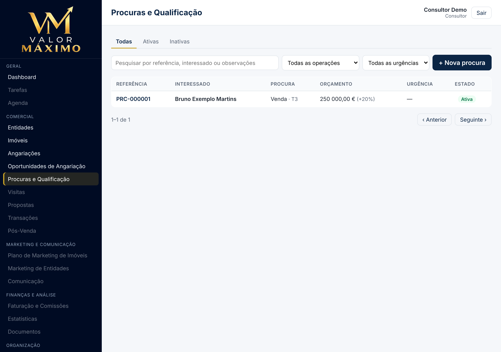

# 7. Procuras e correspondências

Uma **procura** regista o que um cliente quer comprar ou arrendar. O CRM compara-a com os imóveis e mostra os
**compatíveis**, explicando porquê. Referência: PRC-000001, …

## 7.1 Lista

Abra **Procuras e Qualificação** no menu. Separadores **Ativas** / **Inativas**; filtros por «Comprar / Arrendar» e urgência.

## 7.2 Criar

A partir da ficha do cliente (secção **Oportunidades e procuras** → **+ Nova procura**) ou na lista
(**+ Nova procura**).

1. **Interessado:** cliente, **o cliente pretende** (*Comprar* ou *Arrendar*, obrigatório), estado e urgência.
2. **Qualificação do comprador:** destino do imóvel, motivação de compra (de *Muito baixa* a *Muito alta*), se
   a compra depende da venda, **quando iniciou a procura** e **prazo de aquisição** (texto livre, como o cliente
   disse — por exemplo «há 3 meses», «até ao fim do ano»), piso, exposição solar, se aceita obras, **motivo
   para comprar**, o que quer, o que não quer e flexibilidade.
3. **Pré-qualificação financeira:** plafond, modo de pagamento, capitais próprios, financiamento, qualificação
   bancária, entidade bancária e observações.
4. **Orçamento:** orçamento máximo e **tolerância** (de 0 % a 20 %; por omissão 0 %). O CRM mostra o **preço
   máximo aceite**. Exemplo: 250 000 € com 20 % → até 300 000 €.
5. **Critérios do imóvel:** para cada um, preencha o que o cliente quer e escolha:
   - **Obrigatório** — imóveis que não cumprem **não aparecem**;
   - **Preferencial** — imóveis que não cumprem aparecem, mas mais abaixo.

   Critérios em branco não contam.

| Critério | Como é comparado |
|----------|------------------|
| Tipo de imóvel | O tipo do imóvel tem de ser um dos escolhidos |
| Tipologia | Uma das escolhidas |
| Localização | Basta cumprir uma: concelho inteiro, freguesia específica ou zona comercial |
| Quartos / Área / Estacionamento | Igual ou superior ao mínimo (área: bruta privativa ou, se faltar, útil) |
| Zonas exteriores | O imóvel tem de ter **todas** as escolhidas |
| Elevador | O imóvel tem de ter elevador |
| Condição física | Uma das escolhidas |

## 7.3 Imóveis compatíveis

Na ficha da procura, a secção **Imóveis compatíveis** mostra os imóveis que cumprem todos os critérios
obrigatórios, já ordenados:

1. primeiro os que estão **dentro do orçamento**, depois os que estão **dentro da tolerância**, e por fim os que
   **não têm preço indicado**;
2. dentro de cada grupo, os que cumprem **mais preferências**;
3. por fim, o mais barato primeiro.

Para cada imóvel aparece a explicação de cada critério:
- **✓** cumpre; **✗** não cumpre (só em preferenciais — os obrigatórios não cumpridos ficam de fora);
- **?** a informação falta no imóvel (por exemplo, número de quartos por preencher). Se for um critério
  obrigatório, o imóvel aparece com o aviso *«obrigatório(s) por confirmar»*: confirme e complete a ficha do
  imóvel.

**Que imóveis entram?** Só imóveis com status *Ativo*, compatíveis com o que o cliente pretende (*Comprar* → imóveis para venda; *Arrendar* → imóveis para
arrendamento) e com estado de
comercialização *Disponível* ou *Em preparação* (os *Reservados*, *Vendidos*, etc. ficam de fora). Só vê os
imóveis a que o seu perfil dá acesso.

## 7.4 Procuras compatíveis com um imóvel

Na ficha de um imóvel, a secção **Procuras compatíveis** mostra as procuras **ativas** de clientes para as quais
o imóvel serve, com a mesma explicação. É útil quando entra um imóvel novo: veja logo a quem o apresentar.

## 7.5 Estados

As procuras com estado da categoria *Ativa* geram correspondências. Quando o cliente comprar, desistir ou fizer
uma pausa, mude o estado (por omissão: *Concluída*, *Desistiu*, *Em pausa*).
