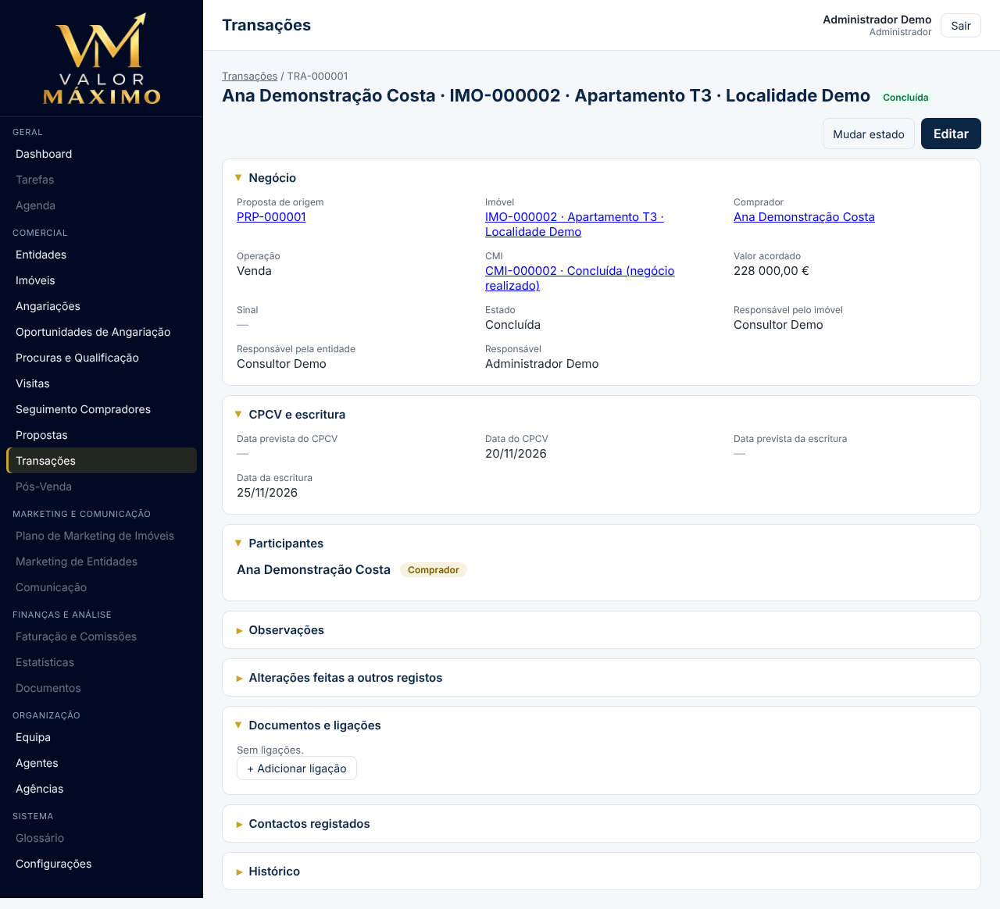

# 10. Transações

A **Transação** reúne os dados confirmados de um negócio: imóvel, comprador, CMI, participantes, valor acordado,
sinal e as datas do CPCV e da escritura (ou do contrato, no arrendamento). Abra **Transações** no menu.

## 10.1 Gerar uma transação a partir de uma proposta aceite

Uma transação nasce sempre de uma **proposta aceite** (capítulo 9). Não se cria do nada.

1. Abra a proposta aceite.
2. Carregue em **Gerar Transação** (no topo da ficha).
3. O ecrã vem preenchido com os dados da proposta: imóvel, comprador, valor da última ronda, sinal, datas
   previstas e participantes. **Ainda não foi gravado nada.**
4. Em **CMI**, escolha o contrato de mediação deste negócio. Se o imóvel tiver vários CMI, escolha o certo; se o
   negócio não tiver CMI, escolha **Sem CMI**. Esta escolha é obrigatória e servirá para calcular a comissão.
5. Confirme a **operação** (venda ou arrendamento), o **valor acordado**, o **sinal** e as **datas previstas**.
6. Confirme os **participantes** (compradores, proprietários, representantes), com os papéis e as quotas.
7. Carregue em **Guardar**. A transação fica *Em preparação*.

Uma proposta só gera **uma** transação: se já existir, o CRM mostra a ligação para a abrir. Na proposta passa a
aparecer o botão **Abrir transação**.

Uma proposta sobre um imóvel **não registado** (de outra agência ou da rede) também pode gerar uma transação,
sem CMI. Nesse caso, indique a operação.

## 10.2 Participantes

Os participantes ficam guardados na própria transação. Se mais tarde mudarem os proprietários do imóvel ou os
participantes da proposta, a transação **não muda**. Para corrigir os participantes da transação, use **Editar**.

## 10.3 Estados

| Venda | Arrendamento |
|-------|--------------|
| Em preparação | Em preparação |
| CPCV assinado | — |
| Escritura marcada | — |
| Concluída (escritura feita) | Concluída (contrato assinado) |
| Cancelada | Cancelada |

Para mudar o estado:

1. Na ficha da transação, carregue em **Mudar estado**.
2. Escolha o **novo estado**. O CRM pede o que for preciso:
   - *CPCV assinado*: a data em que o CPCV foi assinado;
   - *Escritura marcada*: a data marcada para a escritura;
   - *Concluída*: a data da escritura (ou do contrato, no arrendamento);
   - *Cancelada*: o motivo do cancelamento.
3. Ao **concluir**, o CRM propõe alterações a outros registos, já marcadas:
   - o **imóvel** passa a *Vendido* (ou *Arrendado*);
   - o **CMI** passa a *Concluído*.

   Desmarque as que não quiser. **Só se aplicam as que ficarem marcadas.** Nada mais é alterado (outras
   propostas, visitas, procuras e tarefas ficam como estão).
4. Carregue em **Confirmar**.

As datas efetivas não podem ser no futuro. Os nomes dos estados mudam-se em **Configurações → Listas de valores
→ Estados de transação**.

## 10.4 Reabrir

Uma transação concluída ou cancelada pode ser **reaberta**: em **Mudar estado** escolha, por exemplo,
*Em preparação* e indique o **motivo**. Se ao concluir foram feitas alterações ao imóvel ou ao CMI, o CRM propõe
**desfazê-las** (o imóvel volta ao estado anterior e o CMI volta a *Em curso*). Também aqui só se desfaz o que
ficar marcado.

As alterações feitas a outros registos ficam listadas no separador **Alterações feitas a outros registos**, e
tudo fica no histórico e na auditoria.

## 10.5 Documentos, contactos e eliminar

- Em **Documentos e ligações** registe as ligações para o CPCV, a escritura e outros documentos (OneDrive).
- Em **Contactos registados** fica o diário de contactos sobre o negócio.
- Uma transação **concluída** não vai para a lixeira: reabra-a ou cancele-a primeiro. Se o negócio não avançou,
  prefira o estado *Cancelada*.

## 10.6 Quem pode fazer o quê

As permissões seguem a matriz do módulo **Transações** (Configurações / administração): o Consultor vê e edita
as transações de que é responsável; o Responsável de equipa as da sua equipa; o Administrador todas. As
alterações propostas ao imóvel e ao CMI só aparecem a quem também pode editar esses registos.
