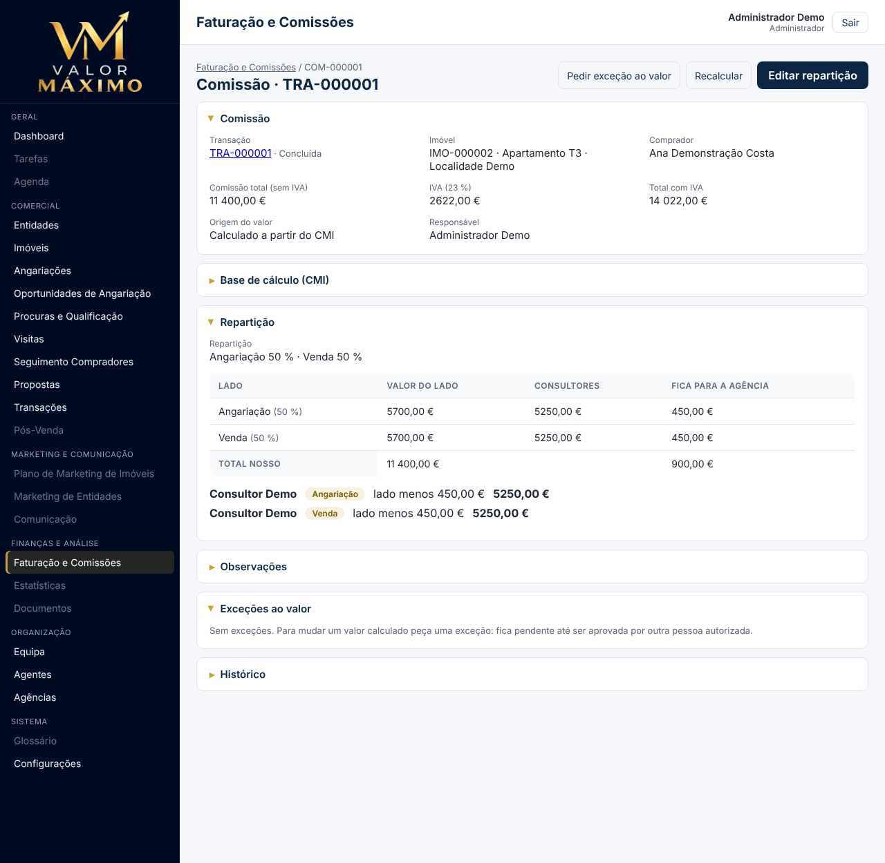
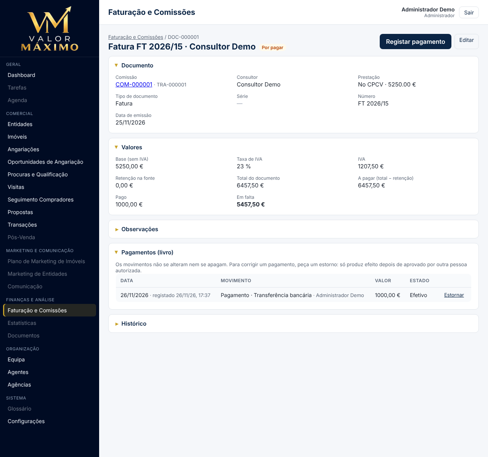

# 11. Faturação e Comissões

Neste capítulo: as **comissões** e a **faturação dos consultores** (os documentos que cada consultor emite à
agência pela sua parte e os pagamentos que a agência lhe faz). O CRM **não emite** faturas: regista as que são
emitidas fora. As faturas da agência aos clientes continuam no programa de faturação da agência.

## 11.1 Como o CRM calcula a comissão

A **comissão total** vem do **CMI** escolhido na transação e do **valor acordado**:

| Modalidade do CMI | Cálculo |
|-------------------|---------|
| Percentagem sobre o valor do negócio | valor acordado × taxa |
| Valor fixo | o valor fixo |
| Número de rendas (arrendamento) | n.º de rendas × renda mensal (o valor acordado da transação) |
| Percentagem sobre base contratual | não se calcula (a base está descrita em texto): indica-se à mão |

- Nunca fica abaixo da **remuneração mínima** do CMI.
- Os valores são **sem IVA**. Se o CMI diz que os valores têm IVA incluído, o CRM retira-o. O IVA e o total com
  IVA aparecem ao lado.
- O CRM guarda uma **fotografia** da base de cálculo (CMI e versão, modalidade, taxa, mínimo, IVA). Se o CMI
  mudar depois, a comissão não muda sozinha; use **Recalcular** para tirar uma nova fotografia.
- Sem CMI (por exemplo, imóvel de outra agência), a comissão fica **Por apurar** até indicar o valor. Por apurar
  não é o mesmo que zero: para «sem comissão», indique 0.

## 11.2 Os dois lados: angariação e venda

A comissão total divide-se em dois lados:

- **Angariação**: da agência que tem o imóvel;
- **Venda**: da agência que tem o comprador.

Por omissão o CRM propõe **50 % / 50 %** (pode mudar este valor em **Configurações → Parâmetros**, e em cada
comissão). Exemplo: venda de 200.000 € com 5 % → comissão total 10.000 € → 5.000 € para cada lado.

Só controlamos os lados que são **nossos**: a angariação, quando o responsável pelo imóvel é da nossa Equipa; a
venda, quando o responsável pelo comprador é da nossa Equipa; ou os dois.

## 11.3 Consultores

Em cada lado nosso, o consultor recebe de uma de duas formas:

- **Percentagem do lado** — ex.: 50 % do lado da angariação: 5.000 € × 50 % = 2.500 €;
- **Lado menos um valor fixo que fica para a agência** — ex.: 5.000 € − 450 € = 4.550 €.

O resto fica para a agência. A forma habitual de cada consultor define-se na sua ficha da **Equipa** (separador
*Comissão habitual*); o CRM propõe-a em cada comissão, onde pode ser mudada.

## 11.4 Apurar a comissão de uma transação

1. Abra a transação (capítulo 10).
2. No separador **Comissão**, carregue em **Apurar comissão**.
3. Abre-se a ficha da comissão com o cálculo, a repartição por lados e os consultores propostos.
4. Para mudar a repartição ou os consultores, carregue em **Editar repartição**, faça as alterações e
   **Guardar**. Os consultores não podem receber mais do que o lado.

## 11.5 Mudar o valor calculado (exceção)

O valor calculado a partir do CMI **não se edita diretamente**. Para o mudar:

1. Na ficha da comissão, carregue em **Pedir exceção ao valor**.
2. Indique o **valor proposto** e o **motivo**. Carregue em **Enviar pedido**.
3. O pedido fica **pendente**: o valor em vigor não muda até ser aprovado.
4. Outra pessoa autorizada (Administrador ou Responsável de equipa) abre a comissão e carrega em **Decidir**
   para **Aprovar** ou **Recusar** (a recusa exige motivo).

Regras: ninguém aprova o próprio pedido; quem recebe parte da comissão também não pode decidir (conflito de
interesses). Fica registado o valor original, o proposto, o final, quem pediu, quem decidiu e quando.

## 11.6 Quem pode fazer o quê

Por omissão: o **Administrador** apura e edita comissões; o **Responsável de equipa** consulta e aprova
exceções da sua equipa; o **Consultor** consulta as comissões dos seus negócios. A matriz pode ser alterada pelo
Administrador.

## 11.7 Prestações de cada consultor

A parte de cada consultor paga-se conforme o **momento do pagamento** indicado no CMI: 100% no CPCV, 50% no
CPCV e 50% na escritura, ou 100% na escritura. No arrendamento paga-se tudo no contrato.

1. Na ficha da comissão, no separador **Pagamentos aos consultores**, carregue em **Propor prestações**.
2. O CRM mostra as prestações de cada consultor, com valores e datas previstas (as datas do CPCV e da escritura
   da transação). Pode ajustar os valores.
3. Carregue em **Confirmar**. Pode voltar a propor mais tarde (as prestações anteriores são substituídas).

Os momentos de pagamento são uma lista configurável (**Configurações → Listas de valores**): cada valor tem uma
categoria (100% CPCV, 50%/50% ou 100% escritura), que é o que o CRM usa no cálculo.

## 11.8 Registar o documento do consultor

1. No separador **Pagamentos aos consultores**, carregue em **Registar documento** na linha do consultor (ou na
   prestação a que o documento se refere).
2. Escolha o **tipo** (fatura, fatura-recibo, recibo ou nota de crédito) e indique a **série**, o **número** e a
   **data de emissão**, como estão no documento.
3. Indique a **base** (sem IVA) e a **taxa de IVA**. O IVA calcula-se sozinho; só o escreva se o documento tiver
   outro valor. Se o documento tiver **retenção na fonte**, indique o valor (o CRM não calcula retenções).
4. Carregue em **Guardar**.

O CRM não deixa registar o mesmo documento duas vezes (mesmo consultor, tipo, série e número) nem um documento de
um consultor que não recebe parte da comissão. Uma **nota de crédito** tem de indicar o documento que retifica e
reduz o valor a pagar ao consultor.

## 11.9 Pagamentos aos consultores

1. Abra o documento e carregue em **Registar pagamento**.
2. Indique a **data** em que pagou, o **valor** (pode ser parcial) e o **meio de pagamento**.
3. Carregue em **Registar**. O documento mostra o **pago** e o **em falta**; a comissão mostra, por consultor, o
   que recebe, o que já faturou, o que foi pago e o que está por pagar.

O CRM recusa pagamentos acima do que falta pagar e datas futuras.

**Os pagamentos não se alteram nem se apagam** (livro de pagamentos). Se um pagamento estiver errado:

1. Na linha do pagamento, carregue em **Estornar**.
2. Indique o **valor** a estornar e o **motivo**. Carregue em **Pedir estorno**.
3. O estorno fica **pendente** e só conta depois de **aprovado** por outra pessoa autorizada (Administrador ou
   Responsável de equipa), que carrega em **Decidir**. Quem pediu e o próprio consultor não decidem.

Enquanto um estorno estiver pendente, esse valor fica reservado: não se pode pedir outro estorno acima do que
resta. Um documento com pagamentos não muda de valores nem vai para a lixeira: corrige-se com uma nota de crédito.

Para ver todos os documentos, abra **Faturação e Comissões → Documentos e pagamentos dos consultores**.
