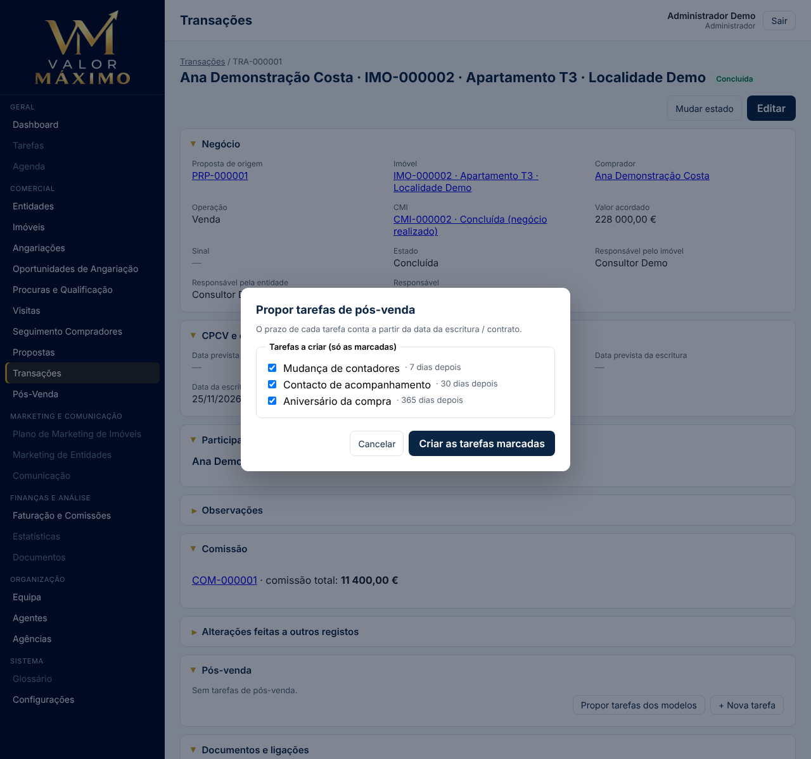
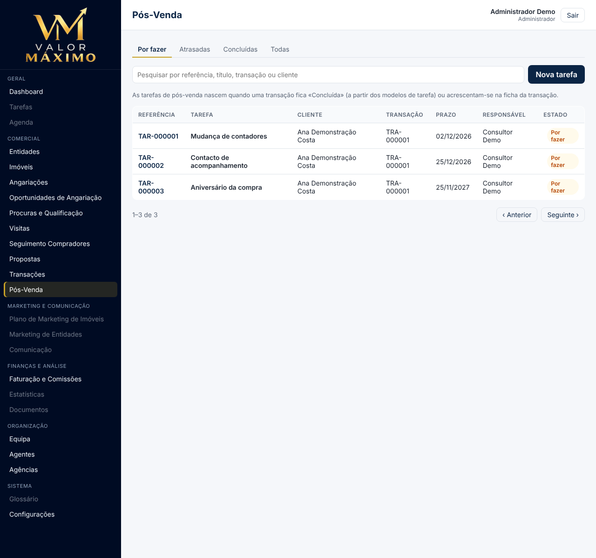

# 12. Pós-Venda

Neste capítulo: o acompanhamento do cliente **depois da escritura** (ou do contrato de arrendamento) e a
lista dos **documentos do negócio**.

## 12.1 O que é uma tarefa de pós-venda

É uma coisa a fazer para um cliente depois do negócio concluído — por exemplo, ajudar a mudar os contadores ou
telefonar um mês depois. Cada tarefa tem referência **TAR-**, está ligada a uma **transação concluída**, e tem
prazo, responsável e estado (Por fazer, Em curso, Concluída, Cancelada).

## 12.2 Tarefas criadas a partir de modelos

O CRM tem **modelos de tarefa** (ver 12.5). Quando passa uma transação a **Concluída**:

1. Na ficha da transação, carregue em **Mudar estado** e escolha **Concluída**.
2. Indique a data da escritura (ou do contrato).
3. Na lista «Alterações propostas a outros registos» aparecem as tarefas dos modelos, por exemplo
   «Criar a tarefa de pós-venda «Mudança de contadores» (prazo: 7 dias depois da escritura)».
4. Deixe marcadas só as que quer criar e carregue em **Confirmar**.

Regras:

- O **prazo** é a data da escritura / contrato mais os dias do modelo.
- O **responsável** é o responsável pelo comprador. Pode mudá-lo depois na tarefa.
- Se reabrir a transação, as tarefas **não** são apagadas.

Também pode criar as tarefas mais tarde, na ficha da transação:

1. No bloco **Pós-venda**, carregue em **Propor tarefas dos modelos**.
2. Aparecem só os modelos ainda não usados nesta transação.
3. Deixe marcadas as que quer e carregue em **Criar as tarefas marcadas**.

## 12.3 Tarefas avulsas

1. Na ficha da transação concluída, bloco **Pós-venda**, carregue em **+ Nova tarefa**
   (ou, no menu **Pós-Venda**, em **Nova tarefa** e escolha a transação).
2. Escreva o título e, se quiser, o prazo, a prioridade e a descrição.
3. Carregue em **Guardar**.

## 12.4 Acompanhar as tarefas

No menu do lado esquerdo, carregue em **Pós-Venda**. Os separadores mostram:

- **Por fazer** — as tarefas por fazer ou em curso;
- **Atrasadas** — as que passaram o prazo (aparecem com a etiqueta vermelha «Atrasada»);
- **Concluídas** e **Todas**.

Na ficha da tarefa:

- **Marcar como concluída** — o CRM regista a data e hora; **Reabrir** volta a pô-la por fazer (pede o motivo);
- **Cancelar tarefa** — quando deixou de fazer sentido (pede o motivo);
- **Contactos e notas** — registe aqui os telefonemas e o que ficou combinado;
- **Editar** — corrige qualquer campo (fica no Histórico).

## 12.5 Modelos de tarefa (Administrador)

1. Vá a **Configurações → Modelos de tarefas** e, em **Módulo**, escolha **Pós-Venda**.
2. Para acrescentar: **+ Novo modelo**, escreva o nome, os **dias depois da escritura / contrato** e, se quiser,
   uma descrição (passa para a tarefa). Carregue em **Guardar**.
3. Para mudar: **Editar**. Para deixar de propor: **Desativar** (as tarefas já criadas mantêm-se).

Os modelos iniciais são: Mudança de contadores (7 dias), Contacto de acompanhamento (30 dias) e Aniversário da
compra (365 dias).

## 12.6 Documentos do negócio

O CRM não guarda ficheiros: guarda a **ligação** para a pasta ou ficheiro (OneDrive, Google Drive…).

1. Na ficha da transação, bloco **Documentos e ligações**, carregue em **+ Adicionar ligação**.
2. Escolha o **Tipo** (por exemplo, Documentos) e, em **Documento do negócio**, que documento é
   (CPCV, Escritura, Caderneta predial, Certificado energético…).
3. Escreva um título, cole o endereço e carregue em **Adicionar**.

No topo do bloco aparece a **lista de verificação**: ✓ para os documentos já ligados e «em falta» para os que
faltam. Numa venda não aparece o contrato de arrendamento, e num arrendamento não aparecem o CPCV nem a
escritura. A lista de documentos muda-se em **Configurações → Listas de valores** («Tipos de documento da
transação»).
