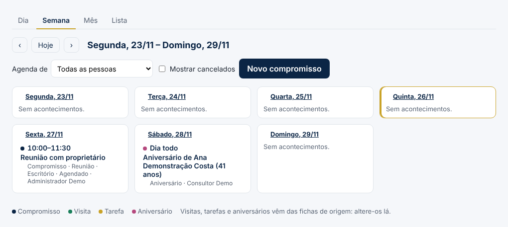
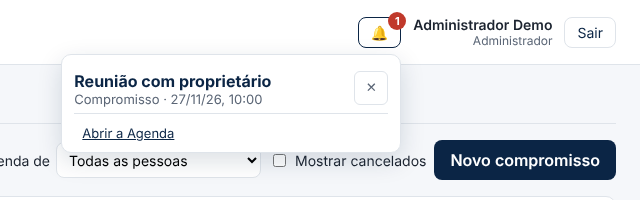

# 13. Agenda e avisos

Neste capítulo: a **Agenda** (os seus compromissos e os acontecimentos dos outros módulos) e os **avisos** do
sino no topo do ecrã.

## 13.1 O que aparece na Agenda

| Cor | O quê | De onde vem |
|-----|-------|-------------|
| Azul escuro | **Compromissos** (reuniões, chamadas…) | Criados na própria Agenda |
| Verde | **Visitas** | Módulo Visitas |
| Dourado | **Tarefas de pós-venda**, no dia do prazo | Módulo Pós-Venda |
| Rosa | **Aniversários** das entidades | Data de nascimento na ficha da entidade |

As visitas, as tarefas e os aniversários **não são copiados** para a Agenda: se mudar a data de uma visita na
ficha da visita, a Agenda mostra logo a nova data. Para os alterar, carregue neles e altere-os na ficha de
origem. Quem nasceu a 29 de fevereiro aparece a 28 de fevereiro nos anos que não são bissextos.

## 13.2 Ver a Agenda

1. No menu do lado esquerdo, carregue em **Agenda**.
2. Escolha a vista no topo: **Dia**, **Semana**, **Mês** ou **Lista** (os próximos 30 dias).
3. Use **‹** e **›** para andar para trás e para a frente; **Hoje** volta ao dia de hoje.
4. Na vista Semana ou Mês, carregue num dia para o ver em detalhe.

Por omissão vê a **sua** agenda. Se for Responsável de Equipa ou Administrador, em **Agenda de** pode escolher
outra pessoa (da sua equipa, ou qualquer pessoa no caso do Administrador) ou **Todas as pessoas**. Cada pessoa só
vê o que as suas permissões deixam ver também no módulo de origem.

Os compromissos e visitas cancelados ficam escondidos; marque **Mostrar cancelados** para os ver (aparecem
riscados).

## 13.3 Criar um compromisso

1. Na Agenda, carregue em **Novo compromisso**.
2. Escreva o **título** e escolha o **tipo** (Reunião, Chamada, Avaliação de imóvel, Outro).
3. Indique o **início** (obrigatório) e, se quiser, o **fim** e o **local**.
4. Se o compromisso for com um cliente ou sobre um imóvel, escolha a **entidade** e/ou o **imóvel**
   (escreva parte do nome ou da referência).
5. Carregue em **Guardar**.

## 13.4 Concluir, cancelar ou reabrir

Na ficha do compromisso:

- **Marcar como concluído** — quando já se realizou;
- **Cancelar compromisso** — pede o **motivo** (fica registado);
- **Reabrir** — volta a pôr como agendado; também pede o motivo.

Use **Editar** para mudar a data, a hora ou outros dados. Tudo fica no **Histórico**. Em **Contactos e notas**
pode registar o que ficou combinado.

## 13.5 Avisos (o sino)

No topo do ecrã, ao lado do seu nome, o sino 🔔 mostra quantos avisos tem. Carregue nele para os ver:

- **compromissos** seus que começam nas próximas 24 horas;
- **visitas** suas que começam na próxima hora (só as que têm hora de entrada);
- **tarefas de pós-venda** suas com prazo hoje.

Carregue num aviso para abrir a ficha. O **✕** dispensa o aviso (só para si). Os avisos são só dentro do CRM: não
são enviados por email.

O Administrador pode mudar a antecedência dos avisos em **Configurações → Parâmetros** («Agenda: aviso dos
compromissos (horas antes)» e «Agenda: aviso das visitas (minutos antes)»). Os tipos de compromisso mudam-se em
**Configurações → Listas de valores** («Tipos de compromisso»).
