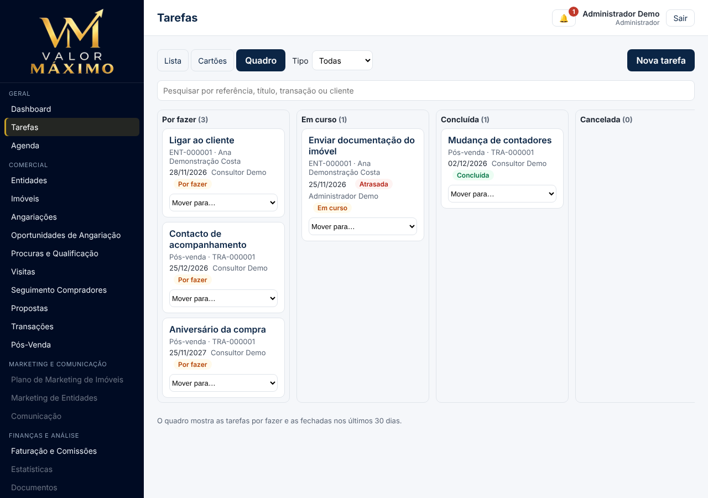
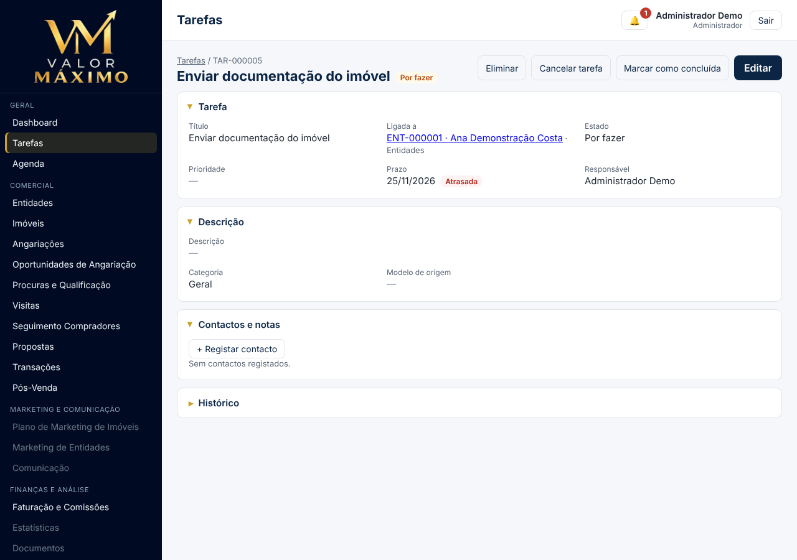

# 13B. Tarefas

Neste capítulo: o menu **Tarefas**, onde estão **todas** as suas tarefas — as **gerais** e as de **pós-venda**
(capítulo 12).

## 13B.1 Tarefas gerais

Uma tarefa geral é uma coisa a fazer (ligar a um cliente, pedir um documento, preparar uma apresentação…). Pode
ficar:

- **solta**, sem ficha; ou
- **ligada a uma ficha** de Entidades, Imóveis, Angariações, Oportunidades, Procuras, Visitas, Propostas ou
  Transações.

Cada tarefa tem referência **TAR-**, título, prazo, prioridade, responsável e estado (Por fazer, Em curso,
Concluída, Cancelada). «Atrasada» aparece sozinha quando o prazo já passou e a tarefa não está concluída.

## 13B.2 Criar uma tarefa

**A partir de uma ficha** (recomendado, fica logo ligada):

1. Abra a ficha (por exemplo, a entidade).
2. No bloco **Tarefas**, carregue em **+ Nova tarefa**.
3. Escreva o título e, se quiser, o prazo, a prioridade e a descrição.
4. Carregue em **Guardar**.

**No menu Tarefas:**

1. Carregue em **Nova tarefa**.
2. Em **Ligada a (módulo)** escolha o módulo e depois procure o **Registo** (escreva parte do nome ou da
   referência) — ou deixe «tarefa solta».
3. Preencha o resto e carregue em **Guardar**.

## 13B.3 Ver as tarefas: Lista, Cartões e Quadro

No topo escolha a vista:

- **Lista** — uma tabela; os separadores mostram *Por fazer*, *Atrasadas*, *Concluídas* e *Todas*;
- **Cartões** — as mesmas tarefas em cartões;
- **Quadro** — uma coluna por estado. Para mudar o estado, **arraste** o cartão para outra coluna ou use
  **Mover para…** no cartão (útil no telemóvel).

Em **Tipo** pode ver só as **Gerais** ou só as de **Pós-venda**.

## 13B.4 Concluir, cancelar ou reabrir

Na ficha da tarefa (ou no Quadro):

- **Marcar como concluída** — o CRM regista a data e a hora;
- **Cancelar tarefa** — pede o **motivo**;
- **Reabrir** — volta a pôr «Por fazer»; também pede o **motivo**.

Pode reabrir quem pode editar a tarefa (o responsável, o Responsável de Equipa e o Administrador). Tudo fica no
**Histórico**; em **Contactos e notas** regista o que foi feito.

## 13B.5 Modelos de tarefa por módulo (Administrador)

1. Vá a **Configurações → Modelos de tarefas**.
2. Em **Módulo**, escolha o módulo (por exemplo, **Entidades**).
3. Carregue em **+ Novo modelo**, escreva o nome (ex.: «Ligar ao cliente») e os **dias depois de criada**
   (ex.: 2). Carregue em **Guardar**.

Depois, em qualquer ficha desse módulo, o bloco **Tarefas** tem **Propor tarefas dos modelos**: aparecem os
modelos ainda não usados nessa ficha; deixe marcados os que quer e carregue em **Criar as tarefas marcadas**.
O prazo conta a partir de hoje e o responsável é o responsável da ficha. Nada é criado sem a sua confirmação.

## 13B.6 Na Agenda

As tarefas com prazo aparecem na **Agenda** no dia do prazo, e no **sino** de avisos no próprio dia (capítulo 13).
