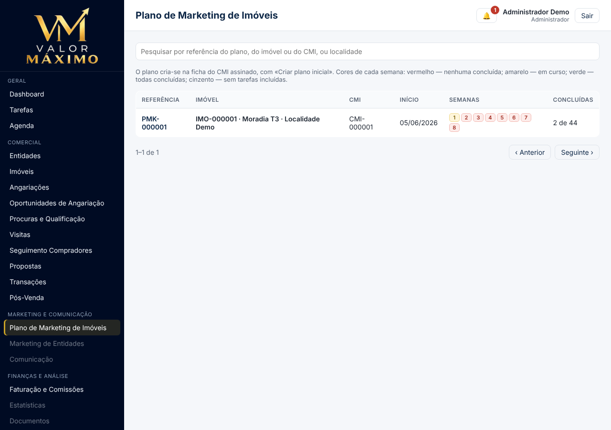
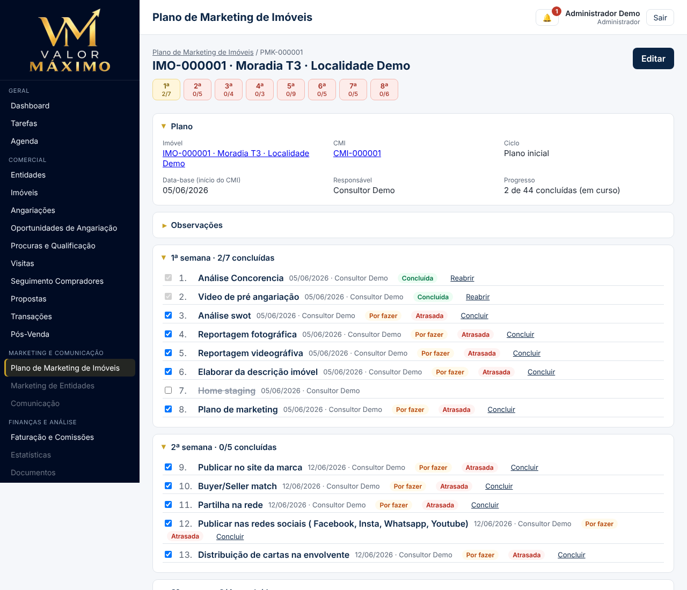

# 14. Plano de Marketing de Imóveis

Neste capítulo: o plano de **45 tarefas em 8 semanas** que se cria para cada imóvel angariado.

## 14.1 O que é

O plano segue o catálogo original da agência: 45 tarefas, da «Análise Concorencia» (1.ª semana) ao
«Buyer/Seller match» (8.ª semana), com os nomes tal como foram definidos. As tarefas da 1.ª semana têm prazo no
**dia de início do CMI**; as da 2.ª semana, 7 dias depois; e assim até à 8.ª semana (49 dias depois).

## 14.2 Criar o plano

O plano cria-se na ficha do **CMI assinado** (com data de início e prazo, e ligado a um imóvel registado).

1. Abra a ficha do CMI.
2. No bloco **Plano de Marketing**, carregue em **Criar plano inicial**.
3. Aparece a lista das 45 tarefas, **todas marcadas**, por semana e com a data de cada uma.
4. Desmarque as que não se aplicam a este imóvel (por exemplo, «Home staging»).
5. Carregue em **Confirmar e criar o plano**.

O responsável das tarefas é o **responsável do imóvel** (pode mudar-se depois, tarefa a tarefa). Cada CMI só tem
um plano inicial.

## 14.3 Acompanhar o plano

No menu **Plano de Marketing de Imóveis** vê todos os planos; na ficha do imóvel e do CMI aparece o resumo.

Na ficha do plano, no topo, cada semana tem uma cor:

| Cor | Significado |
|-----|-------------|
| Cinzento | a semana não tem tarefas incluídas |
| Vermelho | nenhuma tarefa concluída |
| Amarelo | algumas concluídas |
| Verde | todas concluídas |

Só contam as tarefas **incluídas**.

Em cada semana:

- a caixa à esquerda é **Incluir**: desmarque para tirar a tarefa do plano (fica riscada e deixa de aparecer em
  Tarefas e na Agenda); marque para voltar a incluir. Uma tarefa concluída não pode ser desmarcada;
- **Concluir** marca a tarefa como feita; **Reabrir** volta a pô-la por fazer (pede o motivo);
- carregue no nome para abrir a tarefa (mudar o prazo, o responsável, registar notas…). O nome das tarefas do
  plano não se altera.

## 14.4 Nas Tarefas e na Agenda

As tarefas do plano são as mesmas no menu **Tarefas** (em **Tipo**, escolha **Marketing**) e na **Agenda**. Na
Agenda só aparecem se marcar **Mostrar tarefas de marketing** (para não encher a agenda).

## 14.5 Se a data de início do CMI for corrigida

Os prazos das tarefas por fazer podem ser recalculados a partir da nova data; as concluídas não mudam.

1. Na ficha do plano aparece o aviso de que a data de início do CMI é diferente da data-base do plano.
2. O consultor responsável carrega em **Pedir recálculo dos prazos**, vê as datas novas, escreve o motivo e
   carrega em **Enviar pedido**.
3. Um **Responsável de Equipa** ou o **Administrador** (que não seja quem pediu) abre o plano e carrega em
   **Aprovar o recálculo** ou **Recusar** (com motivo).

Os pedidos ficam registados no bloco **Pedidos de recálculo** e no histórico.

## 14.6 Eliminar um plano

Só é possível enquanto nenhuma tarefa estiver concluída (o plano e as tarefas vão para a lixeira). Depois disso,
use a caixa **Incluir** para ajustar o plano.
