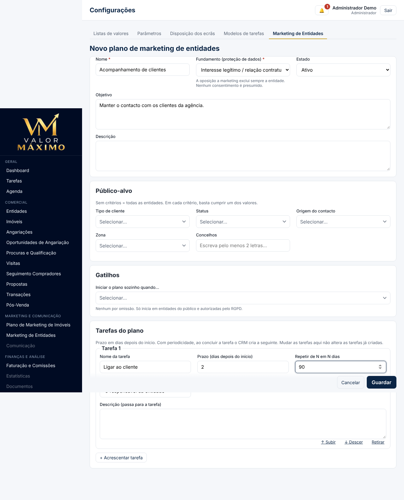
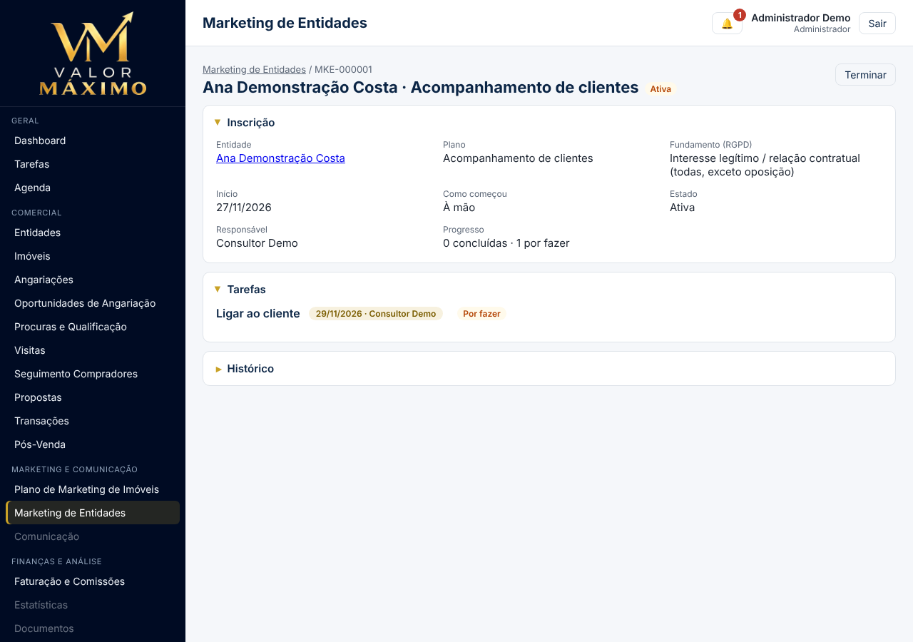

# 15. Marketing de Entidades

Neste capítulo: os **planos de contacto** com os clientes (por exemplo, «ligar a cada 90 dias aos compradores»).
O CRM **não traz planos feitos**: é o Administrador que os cria, e os consultores executam as tarefas.

## 15.1 Regras de proteção de dados (RGPD)

Cada plano indica o seu **fundamento**:

- **Consentimento** — só entram as entidades com consentimento de marketing **concedido**;
- **Interesse legítimo / relação contratual** — entram todas, exceto as que se opuseram.

Regras:

- A **oposição a marketing exclui sempre** a entidade, seja qual for o fundamento.
- O CRM **nunca presume consentimentos**.
- Se uma entidade passar a ter oposição, ou retirar o consentimento num plano que o exige, sai desses planos
  sozinha e as tarefas por fazer são canceladas.

A escolha do fundamento de cada plano deve ser validada por quem trata da proteção de dados na agência.

## 15.2 Criar um plano (Administrador)

1. Vá a **Configurações → Marketing de Entidades** e carregue em **+ Novo plano**.
2. Preencha o **nome**, o **fundamento** e, se quiser, o objetivo e a descrição.
3. Em **Público-alvo** escolha os critérios (tipo de cliente, status, origem do contacto, zona, concelhos). Sem
   critérios, o público são todas as entidades.
4. Em **Gatilhos**, escolha se o plano começa sozinho quando: uma entidade é criada, se regista um contacto, uma
   visita fica «Realizada» ou um negócio fica «Concluído». Por omissão não há nenhum.
5. Em **Tarefas do plano**, carregue em **+ Acrescentar tarefa** e indique o nome, o **prazo** (dias depois do
   início), se se **repete** (de quantos em quantos dias) e o responsável (por omissão, o responsável da
   entidade).
6. Carregue em **Guardar**.

Depois de guardado, ao abrir o plano aparece quantas entidades cumprem o público e quantas o RGPD autoriza.
Mudar as tarefas de um plano não altera as tarefas que já foram criadas. Para deixar de usar um plano, mude o
estado para **Inativo**.

## 15.3 Pôr entidades num plano

Há três maneiras:

- **À mão:** na ficha da entidade, no bloco **Marketing**, escolha o plano em **Associar a um plano** e carregue
  em **Associar**. Se o RGPD não o permitir, aparece o motivo.
- **Para todo o público:** no menu **Marketing de Entidades**, carregue no nome do plano em «Iniciar um plano para
  todo o seu público». Aparece quantas entidades vão entrar e quantas ficam de fora (oposição, falta de
  consentimento, já no plano). Carregue em **Confirmar e iniciar**.
- **Por gatilho:** se o plano tiver gatilhos, começa sozinho.

Ao entrar no plano, o CRM cria as tarefas com os prazos indicados.

## 15.4 Acompanhar

- O menu **Marketing de Entidades** mostra as entidades em cada plano (*Ativas*, *Terminadas*, *Todas*).
- As tarefas são as mesmas na ficha da entidade (bloco **Tarefas**), no menu **Tarefas** e na **Agenda**.
- Quando conclui uma tarefa que se repete, o CRM cria a seguinte (contando a partir do dia em que concluiu).
- Para tirar uma entidade de um plano, abra-a no menu e carregue em **Terminar** (pede o motivo; as tarefas por
  fazer ficam canceladas).

