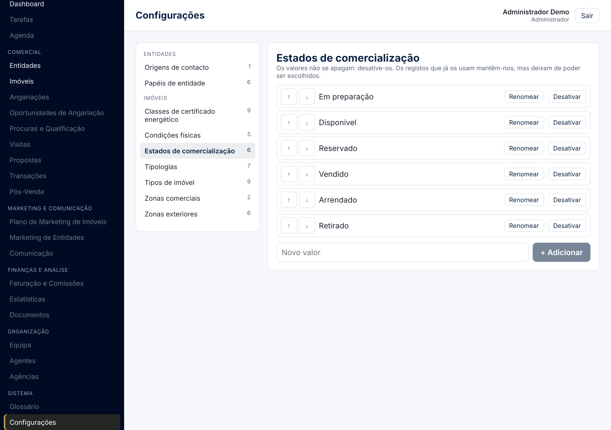
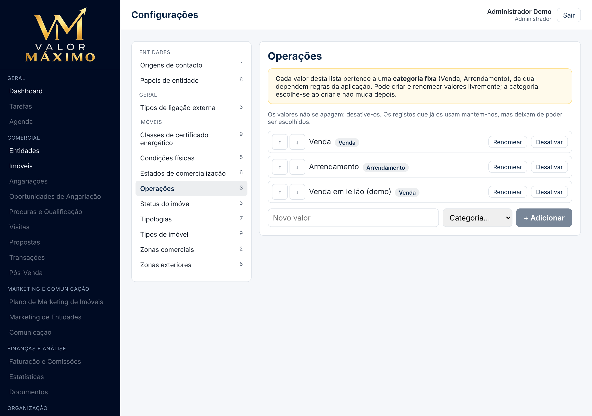
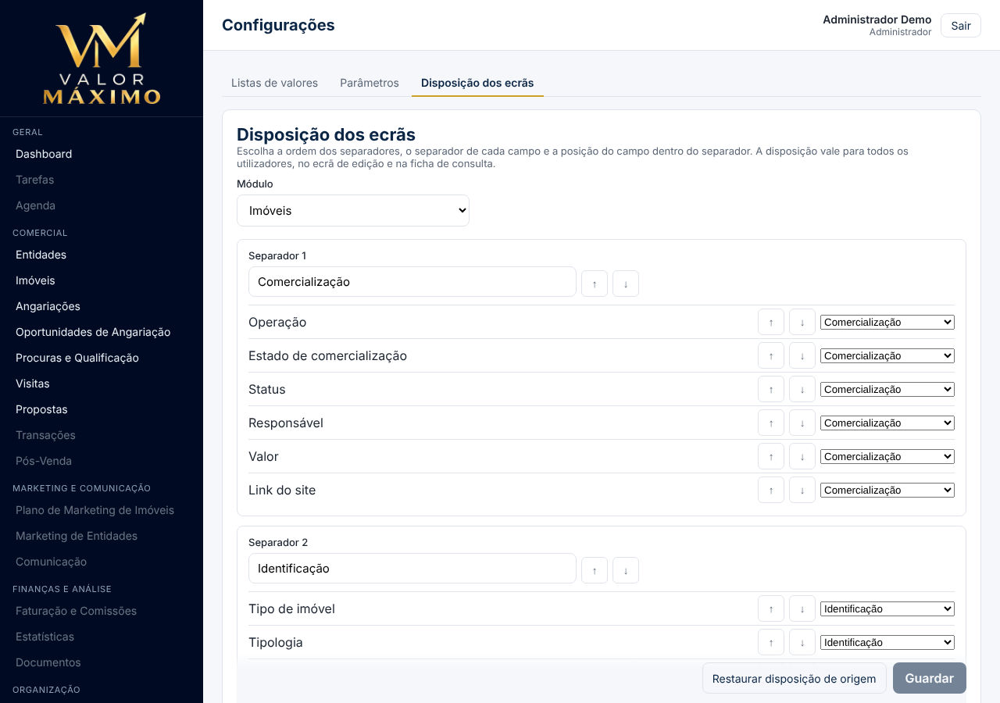
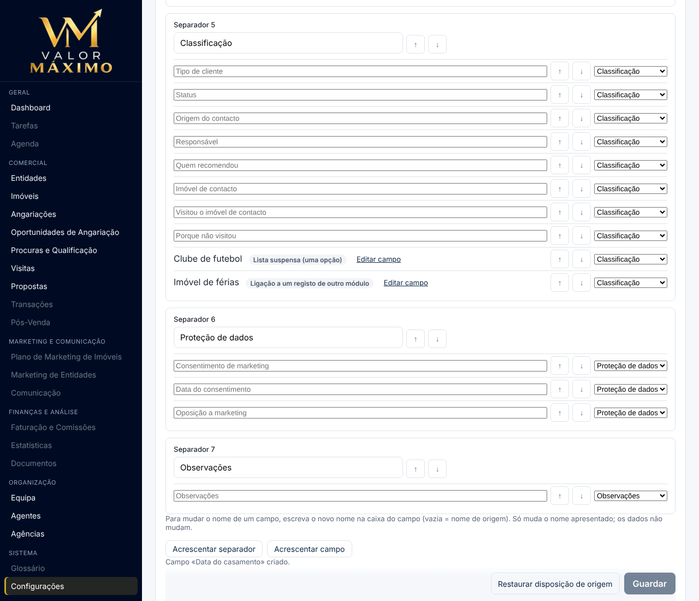

# A. Administração

Esta parte destina-se ao **Administrador**.

## A.1 Listas de valores

Todas as listas suspensas da aplicação (tipos de imóvel, tipologias, estados de comercialização, tipos de
cliente, status, estados civis, Sim/Não/Não sabe, entidades bancárias, momentos de pagamento, origens de contacto, zonas comerciais, …) editam-se em **Configurações → Listas de valores**, sem
qualquer programação.

1. Escolha a lista à esquerda (agrupadas por módulo; o número indica os valores ativos).
2. Para **acrescentar**, escreva o novo valor em *Novo valor* e carregue em **+ Adicionar**.
3. Para **mudar o nome**, carregue em **Renomear**, altere e carregue em **Guardar**. O novo nome passa a
   aparecer em todos os registos que já usavam esse valor.
4. Para **mudar a ordem** em que aparecem nas listas suspensas, use as setas **↑** e **↓**.
5. Para **deixar de usar** um valor, carregue em **Desativar**.

**Porque não há «Apagar»?** Para não estragar registos antigos. Um valor desativado:
- deixa de aparecer nas listas para novos registos;
- continua a aparecer nos registos que já o tinham (e pode ser mantido ao editá-los);
- pode ser **reativado** a qualquer momento.

Todas as alterações às listas ficam registadas na auditoria.

### Listas com categorias fixas

Nas listas **Operações** e **Status do imóvel**, cada valor pertence a uma **categoria fixa**, da qual dependem
regras da aplicação:

| Lista | Categorias | Para que servem |
|-------|------------|-----------------|
| Operações | Venda, Arrendamento | O cálculo de comissões de venda e de arrendamento é diferente. |
| Status do imóvel | Ativo, Inativo, Arquivado | Os imóveis com status da categoria *Arquivado* ficam escondidos da lista por omissão. |
| Estados de comercialização | Em preparação, Disponível, Reservado, Indisponível | Só *Disponível* e *Em preparação* entram nas correspondências com procuras. |
| Estados de oportunidade | Em curso, Angariada, Perdida | Separadores da lista de oportunidades. |
| Estados de procura | Ativa, Inativa | Só as procuras ativas geram correspondências. |

Pode criar os valores que quiser (por exemplo, *Venda em leilão*), mas ao criar tem de escolher a categoria.
Depois de definida, a categoria de um valor **não muda** (pode renomeá-lo, reordená-lo ou desativá-lo). Se um
valor antigo aparecer *«Sem categoria — escolher…»*, escolha-a uma vez na lista ao lado do nome.

A lista **Tipos de ligação externa** (Fotografias, Documentos, Outro) define os tipos usados nas ligações
para pastas do OneDrive ou de outros serviços.

## A.2 Parâmetros

Em **Configurações → Parâmetros** alteram-se parâmetros de funcionamento:

- **Avisos de expiração do CMI:** dias antes do fim em que aparecem avisos (por omissão 120, 60 e 30).
  Escreva os valores separados por vírgulas e carregue em **Guardar**.
- **Exigir início de sessão em dois passos aos Administradores:** *Sim* (por omissão e recomendado) ou *Não*.
  Com *Não*, os Administradores deixam de ser obrigados a usar o código do telemóvel e podem desligá-lo em
  **A minha conta** (capítulo 1). A alteração grava-se logo ao escolher e fica na auditoria.

As listas **Regimes de contrato (CMI)** (categorias Exclusivo / Não exclusivo) e **Papéis de interveniente
(CMI)** editam-se em *Listas de valores*.

## A.3 Disposição dos ecrãs

Em **Configurações → Disposição dos ecrãs** o Administrador escolhe como os campos aparecem em cada módulo.
A disposição vale **para todos os utilizadores**, tanto no ecrã de edição como na ficha de consulta.

1. Em **Módulo**, escolha o módulo: Entidades, Imóveis, Angariações (CMI), Oportunidades de Angariação,
   Procuras e Qualificação, Visitas, Interesses, Propostas, Agentes, Agências ou Equipa (membros).
2. Para mudar a **ordem dos separadores**, use as setas **↑** e **↓** ao lado do nome do separador.
3. Para mudar o **nome** de um separador, escreva o novo nome na caixa do separador.
4. Para mudar a **posição de um campo** dentro do separador, use as setas **↑** e **↓** ao lado do campo.
5. Para passar um campo para **outro separador**, escolha o separador na lista à direita do campo. O campo
   fica no fim desse separador; depois pode subi-lo com **↑**.
6. Para criar um separador novo, carregue em **Acrescentar separador** e mova campos para ele. Um separador
   vazio pode ser removido com **✕**.
7. Carregue em **Guardar**. A alteração fica registada na auditoria.

Para voltar à disposição original do CRM, carregue em **Restaurar disposição de origem**.

Alguns campos só aparecem num dos ecrãs (por exemplo, *Tempo restante* só na consulta e *Palavra-passe* só na
edição); a lista indica-o entre parênteses. Um separador sem campos aplicáveis não aparece.

As secções que mostram registos ligados (por exemplo *Angariações*, *Visitas*, *Ligações* e *Histórico*) não
são campos: aparecem sempre no fim da ficha.

### Mudar o nome de um campo

1. Em **Configurações → Disposição dos ecrãs**, escolha o módulo.
2. Cada campo tem uma caixa com o nome de origem em cinzento. Escreva lá o nome que prefere
   (por exemplo, *Correio eletrónico* em vez de *Email*).
3. Carregue em **Guardar**. O novo nome aparece na edição e na ficha de consulta, para todos.

Para voltar ao nome de origem, apague o texto da caixa e guarde. Mudar o nome **não mexe nos dados**: só muda o
que se lê no ecrã. Nos campos compostos (por exemplo, *Proprietários* ou *Partes*), o nome novo aparece como
título por cima da lista.

## A.4 Acrescentar campos

O Administrador pode acrescentar campos novos a qualquer módulo, sem mexer no programa.

1. Em **Configurações → Disposição dos ecrãs**, escolha o módulo.
2. Se tiver alterações por guardar, carregue primeiro em **Guardar**.
3. Carregue em **Acrescentar campo**.
4. Escreva o **Nome do campo** (por exemplo, *Clube de futebol*).
5. Escolha o **Tipo de campo**:
   - *Texto*, *Texto longo*, *Número inteiro*, *Número decimal*, *Valor em euros*, *Data*, *Email*,
     *Link (endereço de site)*, *Telefone*, *Sim / Não*;
   - *Lista suspensa (uma opção)* ou *(várias opções)*: as opções acrescentam-se depois em
     **Listas de valores**, numa lista com o mesmo nome do campo;
   - *Ligação a um registo de outro módulo* (ou *a vários registos*): escolha em **Liga a registos de** o
     módulo (por exemplo, *Imóveis*). Na ficha aparece a ligação para abrir esse registo. Cada pessoa só vê e
     só pode escolher os registos a que tem acesso.
6. Escolha o **Separador** onde o campo fica. Depois pode mudá-lo de sítio como os outros campos.
7. Diga se o **preenchimento é obrigatório** e, se quiser, escreva um **texto de ajuda**.
8. Carregue em **Criar campo**.

Para alterar um campo acrescentado, carregue em **Editar campo** ao lado dele. Pode mudar o nome, o
preenchimento obrigatório e a ajuda. O **tipo não muda** depois de criado, para não estragar os valores já
gravados. Se precisar de outro tipo, crie um campo novo.

**Desativar e remover (para nunca perder dados):**

- **Desativar** esconde o campo de todos os ecrãs, mas os valores já gravados ficam guardados. Os campos
  desativados aparecem em *Campos desativados*, onde pode **Reativar** um campo, e os valores voltam a aparecer.
- **Remover** só é possível enquanto nenhum registo tiver um valor nesse campo.

As alterações aos campos ficam registadas na auditoria. Os valores dos campos ficam no histórico de cada
registo, como os outros campos.
